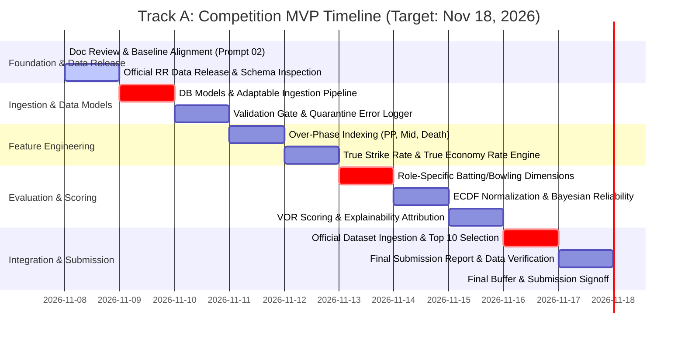
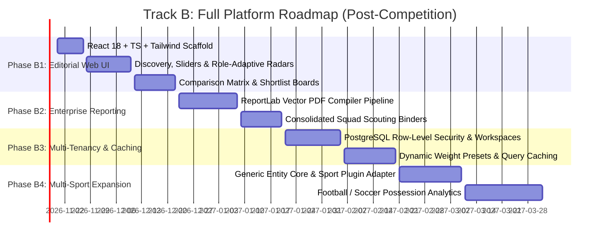

# VYNTIQ — Development Roadmap & Execution Plan

**Document Reference:** ROAD-VYNTIQ-002  
**Document Version:** 2.0.0 (Post-Architecture Review & Competition MVP Alignment)  
**Status:** Approved Architectural Baseline  

---

## 1. Two-Track Execution Strategy

VYNTIQ's development roadmap is bifurcated into two distinct tracks:
1. **Timeline A: Competition MVP** — A 10-day intensive sprint (November 8–18, 2026) engineered to deliver an audit-ready, mathematically rigorous cricket scouting solution for the **SuperRR Selector Season 2** competition.
2. **Timeline B: Full Platform** — A structured post-competition commercialization roadmap expanding VYNTIQ into an enterprise sports intelligence platform.

---

## 2. Timeline A: Competition MVP (November 8 – November 18, 2026)

### Detailed Phase Specifications (Timeline A)

#### Phase A0: Architecture Baseline & Planning (Day 0: Nov 8, Morning)
* **Objective:** Complete architecture review, resolve inconsistencies, establish scoring methodology and data dictionary.
* **Deliverables:** Ten comprehensive documentation files in `docs/`.
* **Verification:** Zero application code written, zero dependencies installed, stakeholder approval.

#### Phase A1: Official Data Release Inspection & Scaffolding (Day 0: Nov 8, 6:00 PM IST)
* **Objective:** Ingest and inspect the official SuperRR Season 2 dataset released at 6 PM IST.
* **Deliverables:**
  * Inspection report of official file format, headers, delimiters, and sample values.
  * Column mapping configuration linking official fields to canonical `DATA_DICTIONARY.md`.
* **Verification:** Scripted header inspection completes with 100% of required fields mapped or flagged as missing.

#### Phase A2: Project Foundation, Database Models & Ingestion Pipeline (Days 1–2: Nov 9–10)
* **Objective:** Establish the modular backend structure and the flexible ingestion/quarantine pipeline.
* **Deliverables:**
  * FastAPI application scaffold with SQLAlchemy 2.0 models (`Deliveries`, `Matches`, `Players`, `Workspaces`).
  * Pydantic v2 ingestion schema and quarantine logging system.
* **Verification:** Ingestion test suite successfully parses sample datasets and logs invalid rows to quarantine.

#### Phase A3: Cricket Feature Engineering & True Metrics (Days 3–4: Nov 11–12)
* **Objective:** Build vectorized Pandas/NumPy feature extractors for T20 match phases and context-adjusted rates.
* **Deliverables:**
  * Over-phase partitioning (Powerplay 1–6, Middle 7–15, Death 16–20).
  * True Strike Rate (TSR) and True Economy Rate (TER) calculation functions baselined to phase/venue averages.
  * Pace vs. Spin matchup aggregations.
* **Verification:** Unit tests confirm True Metrics and phase aggregations match hand-calculated test cases.

#### Phase A4: Role-Specific Evaluation & Normalization Engine (Days 5–6: Nov 13–14)
* **Objective:** Implement role archetypes, 6-axis batting and bowling dimensions, and ECDF percentile normalization.
* **Deliverables:**
  * Batting evaluation module (6 dimensions: TSR, Boundary %, Balls/Dismissal, Dot %, Phase, Matchup).
  * Bowling evaluation module (6 dimensions: TER, Strike Rate, Dot %, Boundary Supp., Phase, Discipline).
  * All-Rounder dual evaluation and balance bonus calculator.
  * ECDF normalization service with directional scaling ($0–100$).
  * Bayesian reliability shrinkage discount factor ($C$).
* **Verification:** Verification tests assert all dimensional scores lie in $[0, 100]$ and regress properly under small samples.

#### Phase A5: VYNTIQ Overall Rating (VOR), Attribution & Ranking (Days 7–8: Nov 15–16)
* **Objective:** Implement composite scoring, factor attribution cards ("The Story Behind the Metric"), and candidate ranking.
* **Deliverables:**
  * VOR composite calculation engine using configurable role presets.
  * Feature attribution generator decomposing top strengths and drag factors.
  * Head-to-head multi-player comparison matrix with delta indicators ($+\Delta / -\Delta$).
* **Verification:** Deterministic ranking of candidate pools with 100% traceable calculation logs.

#### Phase A6: Official Candidate Evaluation & Submission Report (Days 9–10: Nov 17–18)
* **Objective:** Run the full pipeline on official competition data, select Top 10 prospects, and compile the final submission report.
* **Deliverables:**
  * Top 10 Candidate Shortlist for Rajasthan Royals ecosystem with role badges and confidence ratings.
  * Comprehensive, audit-ready competition submission dossier (PDF / structured Markdown).
  * Data audit manifest verifying raw delivery ID lineage for every recommended player.
* **Verification Gate (Nov 18, 2026):** Submission report verified against competition rules and submitted before deadline.

---

## 3. Timeline B: Full VYNTIQ Platform (Post-Competition Roadmap)

### Detailed Phase Specifications (Timeline B)

#### Phase B1: Editorial Web Application (Nov 20 – Dec 22, 2026)
* **Objective:** Build the React 18, TypeScript, and Tailwind CSS web application implementing the editorial design system.
* **Deliverables:** Universal discovery view, faceted sliders, role-adaptive SVG radar charts, head-to-head comparison grid.
* **Verification:** 100% compliance with `DESIGN_SYSTEM.md` visual tokens; sub-200ms page load times.

#### Phase B2: Headless Vector PDF Reporting Engine (Dec 23, 2026 – Jan 20, 2027)
* **Objective:** Build the server-side ReportLab document compiler.
* **Deliverables:** High-speed vector PDF generation pipeline for single-player dossiers and multi-player squad binders.
* **Verification:** Generated vector PDFs compile in $< 2.5\text{ seconds}$ with selectable typography and crisp vector lines.

#### Phase B3: Multi-Tenant Enterprise Security & Performance (Jan 21 – Feb 20, 2027)
* **Objective:** Implement production-grade multi-tenancy and caching for commercial SaaS deployment.
* **Deliverables:** PostgreSQL Row-Level Security, Redis query caching, dynamic client-side weight sliders.
* **Verification:** Multi-tenant penetration tests verify complete tenant isolation under concurrent user loads.

#### Phase B4: Multi-Sport Engine Expansion (Feb 21 – Apr 1, 2027)
* **Objective:** Implement the sport-agnostic abstraction core and deploy the Football/Soccer domain engine.
* **Deliverables:** Generic event models, possession sequence extractors, and xG/xA metric modules.
* **Verification:** Platform ingests soccer event feeds and displays football player performance profiles without code modifications to the platform core.

---

## 4. Definition of Done (DoD) Summary

| Track | Quality Attribute | Standard |
| :--- | :--- | :--- |
| **Track A (MVP)** | Code Coverage | $\ge 85\%$ coverage on ingestion, feature engineering, and scoring logic |
| **Track A (MVP)** | Auditability | 100% of player ratings queryable down to raw delivery IDs |
| **Track A (MVP)** | Submission Readiness | Formatted report delivered with Top 10 candidates by Nov 18, 2026 |
| **Track B (Full)** | Visual Fidelity | Zero unformatted numbers; strict adherence to editorial dark palette |
| **Track B (Full)** | Multi-Sport Scalability| Generic core shared across sports without schema regressions |
