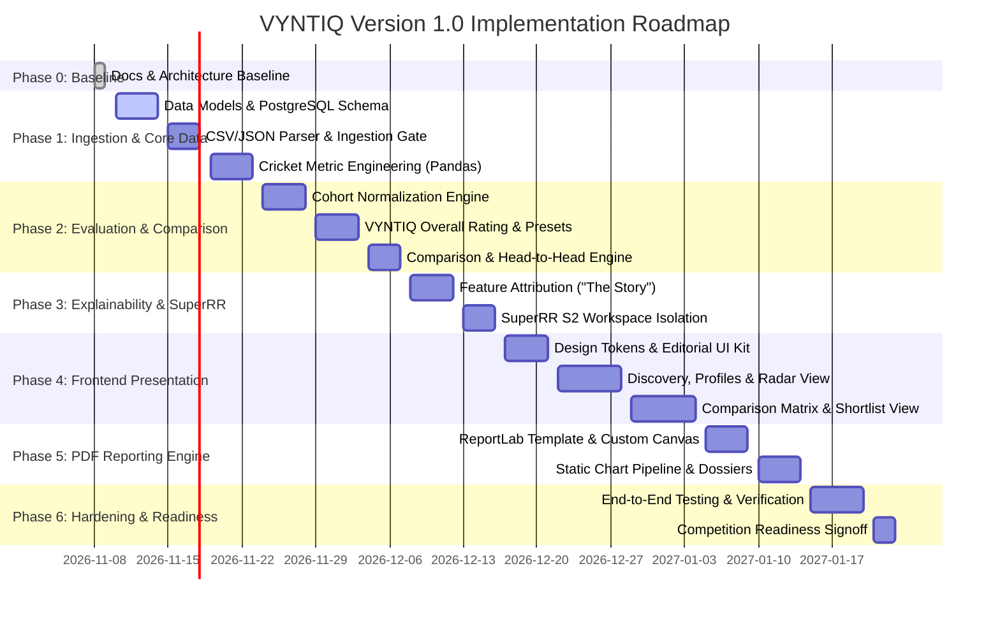

# VYNTIQ — Development Roadmap & Execution Plan

**Document Reference:** ROAD-VYNTIQ-001  
**Target Horizon:** Version 1.0 (Cricket & SuperRR Workspace Release)  
**Document Version:** 1.0.0  
**Status:** Approved Architectural Baseline  

---

## 1. Phased Delivery Overview

The execution roadmap is structured into 7 sequential phases. Each phase culminates in an explicit verification gate that must pass before proceeding.

---

## 2. Detailed Phase Breakdown

### Phase 0: Product Foundation & Architecture (Current Phase)
* **Objective:** Define product vision, requirements, technical architecture, feature map, design system, tech stack, and execution roadmap.
* **Deliverables:** Complete planning documents in `/docs/`.
* **Gate 0 Verification:** Architectural documentation approval from product stakeholders. Zero premature code or dependencies installed.

---

### Phase 1: Core Data Ingestion, Cricket Metric Engineering & Database Models
* **Objective:** Build the foundational relational models, validation gate, and cricket feature extraction pipeline.
* **Key Tasks:**
  1. Initialize FastAPI backend structure and PostgreSQL schemas (SQLAlchemy 2.0 / Alembic).
  2. Implement Pydantic v2 validation models for matches, innings, deliveries, and players.
  3. Build the dataset ingestion pipeline with automatic checksum, duplicate checking, and quarantine logic.
  4. Implement vectorized Pandas/NumPy cricket feature extractors:
     * Phase-of-play categorization (Powerplay 1–6, Middle 7–15, Death 16–20).
     * Dot ball percentage, Boundary rate, Balls per dismissal.
     * True Strike Rate (TSR) and True Economy Rate (TER) baselined to phase/venue scoring indices.
* **Verification Gate 1:** Comprehensive Pytest test suite validating ingestion against a standard multi-season cricket dataset. 100% of invalid rows correctly quarantined with diagnostics.

---

### Phase 2: Player Evaluation & Comparison Engines (Cricket Domain)
* **Objective:** Implement multi-dimensional normalization, role archetypes, and comparative analysis algorithms.
* **Key Tasks:**
  1. Build cohort normalization service using ECDF percentile scoring ($0–100$) for each metric dimension.
  2. Define role archetypes:
     * *Finisher* (weighted toward Death SR, Boundary % in overs 16–20).
     * *Powerplay Enforcer* (weighted toward Overs 1–6 SR, Dot Ball Suppression).
     * *Anchor / Rotator* (weighted toward Stability, Strike Rotation).
     * *Death Bowler* (weighted toward Overs 16–20 Economy, Dot %, Wicket Threat).
     * *Middle Enforcer Bowler* (weighted toward Wickets in overs 7–15, Dot %).
  3. Implement the VYNTIQ Overall Rating (VOR) calculation with customizable weight vectors.
  4. Build head-to-head comparison engine computing absolute deltas ($+\Delta / -\Delta$) and mutual encounter records.
* **Verification Gate 2:** Numerical verification tests asserting that composite scores, percentiles, and deltas match hand-computed analytical gold standards.

---

### Phase 3: Explainable Recommendation Engine & Workspace Management
* **Objective:** Create the "Story Behind the Metric" attribution engine and implement tenant workspace isolation.
* **Key Tasks:**
  1. Develop the feature attribution generator: Decompose composite score deltas against the cohort median into plain-English analytical drivers.
  2. Implement multi-tenant workspace architecture:
     * Logical partition between canonical baseline data and competition-specific datasets.
     * SuperRR Selector Season 2 workspace configuration (squad constraints, specific tournament criteria).
  3. Implement recruitment shortlist CRUD services with analyst notes, tier tags, and priority rankings.
* **Verification Gate 3:** Attribution engine successfully generates traceable, human-readable explanations for all rated players. Workspace data queries strictly isolated with zero cross-tenant leakage.

---

### Phase 4: Frontend Core (Editorial Design System, Discovery, Profiles, Comparisons)
* **Objective:** Build the React 18 / TypeScript / Tailwind CSS presentation layer implementing the VYNTIQ editorial design system.
* **Key Tasks:**
  1. Configure Tailwind CSS with the official VYNTIQ palette (`Deep Charcoal #111318`, `Royal Magenta #D62978`, `Sage Lime #B9D66C`, `Warm Ivory #F1EFEA`).
  2. Build custom headless UI component library (Metric Pills, Tabular Data Cells with `tabular-nums`, Filter Drawers, Range Sliders, Tier Badges).
  3. Build Player Discovery view with sub-second faceted search and cohort filters.
  4. Build Player Performance Profile view with 6-axis SVG/Canvas Capability Radar and phase-of-play tables.
  5. Build Multi-Player Comparison Matrix with delta badges and overlaid radar charts.
  6. Build Shortlist Management & Workspace Switcher views.
* **Verification Gate 4:** Responsive cross-browser visual verification; 100% compliance with strict editorial design rules (no generic gradients, no glowing borders, no unformatted numbers).

---

### Phase 5: Automated PDF Reporting Engine (ReportLab) & Custom Shortlists
* **Objective:** Develop the headless server-side PDF generation pipeline.
* **Key Tasks:**
  1. Implement ReportLab custom `BaseDocTemplate` with editorial multi-column grid, margins, and typography styles.
  2. Build reusable Flowables: Hero Bio Header, Rating Badge, Phase Split Table, Explainability Story Box.
  3. Implement static vector chart generation pipeline to render high-DPI capability radars directly into PDF canvases.
  4. Implement single-player 3-page scouting dossier compilation endpoint.
  5. Implement multi-player batch scouting binder export.
* **Verification Gate 5:** Generated PDFs compile in $< 2.5\text{ seconds}$, render crisply in vector format, and faithfully reflect the VYNTIQ editorial identity.

---

### Phase 6: System Hardening, Benchmarking & Competition Readiness
* **Objective:** Execute performance optimization, security review, and full end-to-end integration testing.
* **Key Tasks:**
  1. Benchmark API latency under concurrent query load (assert p95 $< 200\text{ ms}$).
  2. Validate database indexing and query execution plans on partition tables.
  3. Perform security audits on file upload endpoints, SQL injection vectors, and workspace authorization boundaries.
  4. Perform SuperRR Selector Season 2 dress rehearsal: Ingest competition dataset, generate scouting shortlists, and export PDF dossiers.
* **Verification Gate 6:** 100% test pass rate across unit, integration, and E2E suites. Formal sign-off for competition deployment.

---

## 3. Unresolved Architectural Decisions (For Stakeholder Alignment)

| # | Architectural Decision | Options Under Consideration | Trade-Offs & Current Recommendation |
| :--- | :--- | :--- | :--- |
| **D-1** | **Ball-by-Ball Data Storage Strategy** | **Option A:** Full normalization into relational tables (`matches`, `innings`, `deliveries`). **Option B:** Hybrid approach with match metadata in relational tables and deliveries in compressed Parquet/Arrow files on disk. | **Recommendation: Option A** for Version 1.0 (PostgreSQL partition tables). Relational indexing allows instant multi-dimensional SQL querying across phases and bowler types without reading multi-gigabyte flat files. |
| **D-2** | **Static Chart Generation for ReportLab PDFs** | **Option A:** Use Kaleido to rasterize Plotly figures to 300-DPI PNGs and insert into PDF. **Option B:** Draw radars and curves natively using ReportLab `Drawing` and `Polygon` vector shapes. | **Recommendation: Option B** for primary capability radars (produces pure vector lines with zero raster artifacting); **Option A** as fallback for complex scatter distributions. |
| **D-3** | **Workspace Multi-Tenancy Strategy** | **Option A:** Row-Level Security (RLS) with `workspace_id` column on all tenant tables. **Option B:** PostgreSQL Schema-per-workspace isolation (`schema_canonical`, `schema_super_rr_s2`). | **Recommendation: Option A** for ease of cross-cohort analytics, with strict foreign key constraints and FastAPI dependency injection enforcement. |
| **D-4** | **Confidence Interval Weighting on Small Samples** | **Option A:** Hard cutoff (player excluded if $< 30$ balls faced). **Option B:** Bayesian Shrinkage (regress player metric toward cohort mean proportional to sample variance). | **Recommendation: Option B + Option A hybrid**. Display metric with an explicit Bayesian regression towards the mean, accompanied by a prominent "Low Sample Size" disclaimer badge. |

---

## 4. Immediate Recommended Next Step

Upon review and formal approval of this planning baseline:
* **Recommended Next Step:** Initiate **Phase 1: Project Scaffolding & Core Data Models**.
  * Initialize the Git repository structure with backend (`/backend`) and frontend (`/frontend`) directories.
  * Define SQLAlchemy 2.0 database schemas and Pydantic v2 models for canonical and workspace cricket entities.
  * Setup Pytest testing harness and verify data validation rules with unit tests.

