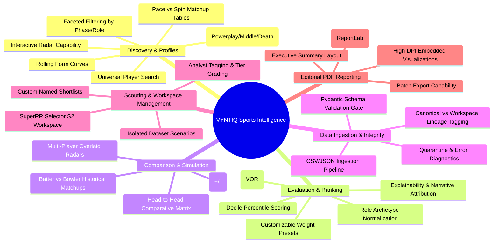

# VYNTIQ — Feature Map & Prioritization Matrix

**Document Reference:** FEAT-VYNTIQ-001  
**Document Version:** 1.0.0  
**Status:** Approved Architectural Baseline  

---

## 1. Feature Map by Functional Domain



---

## 2. Granular Module Specifications

### Module 1: Player Discovery & Exploration
| Feature ID | Feature Name | Inputs | Computational Mechanism | Primary Output | Target User |
| :--- | :--- | :--- | :--- | :--- | :--- |
| **F-DISC-01** | Sub-Second Player Search | Name string, team, nation | Trigram similarity indexing + prefix matching | Matched player list with biographical badges | All Users |
| **F-DISC-02** | Role & Phase Filter Bar | Role, phase, minimum balls/innings | Dynamic SQL/DataFrame filtering with cohort re-indexing | Filtered player cohort matching criteria | Scout, Analyst |
| **F-DISC-03** | Statistical Threshold Sliders | Sliders: Min SR, Max Economy, Min Dot % | Continuous boundary filtering with instant count update | Real-time filtered grid | Analyst |
| **F-DISC-04** | Cohort Percentile Benchmarking | Selected cohort (e.g. IPL 2024 Middle-Overs) | Empirical Cumulative Distribution Function (ECDF) calculation | Percentile ranks ($P_{10} \dots P_{99}$) for all metrics | Analyst, Director |

### Module 2: Player Deep-Dive Performance Profile
| Feature ID | Feature Name | Inputs | Computational Mechanism | Primary Output | Target User |
| :--- | :--- | :--- | :--- | :--- | :--- |
| **F-PROF-01** | Capability Radar Profile | Player ID, comparison cohort | 6-axis dimensional score normalization ($0–100$) | Interactive SVG/Canvas Polygon Radar | Scout, Director |
| **F-PROF-02** | Phase Breakdown Grid | Player ID, date range | Ball-by-ball aggregation grouped by Over Phase (1–6, 7–15, 16–20) | Tabular matrix with Runs, SR, Dot %, Boundaries | Analyst |
| **F-PROF-03** | Tactical Splits (Pace vs Spin) | Player ID | Ball-by-ball aggregation grouped by bowler arm/type | Split card comparing Pace vs Spin vulnerabilities | Scout, Analyst |
| **F-PROF-04** | Rolling Form & Trendline | Player ID, window size (e.g. 5 innings) | Exponentially weighted moving average (EWMA) | Form trajectory chart with confidence bands | Scout, Director |

### Module 3: Evaluation, Scoring & Explainability
| Feature ID | Feature Name | Inputs | Computational Mechanism | Primary Output | Target User |
| :--- | :--- | :--- | :--- | :--- | :--- |
| **F-EVAL-01** | VYNTIQ Overall Rating (VOR) | Player ID, active role preset | Weighted multi-attribute utility summation ($\sum w_i S_i$) | Composite score ($0–100$) and Tier badge | All Users |
| **F-EVAL-02** | Interactive Weight Customizer | Slider values for metric weights | Real-time client/server dot-product recalculation | Updated rankings and score breakdown | Analyst |
| **F-EVAL-03** | Explainability Attribution Card | Calculated score | Shapley-style feature contribution ($\Delta_i \times w_i$) | "Story Behind the Metric" positive/negative drivers | Director, Evaluator |
| **F-EVAL-04** | True Metric Normalization | Venue, phase, raw strike/economy | Phase & venue baseline deviation subtraction | True Strike Rate (TSR) & True Economy Rate (TER) | Analyst |

### Module 4: Comparative Head-to-Head Matrix
| Feature ID | Feature Name | Inputs | Computational Mechanism | Primary Output | Target User |
| :--- | :--- | :--- | :--- | :--- | :--- |
| **F-COMP-01** | Multi-Player Matrix (2–4 Players)| Selected Player IDs | Aligned tabular joining with delta calculation against benchmark | Side-by-side comparative grid with bold winners | Scout, Director |
| **F-COMP-02** | Overlaid Radar Visualizer | 2–4 Player IDs | Multi-polygon rendering with distinct contrast color strokes | Overlaid radar canvas with interactive legend | Analyst, Director |
| **F-COMP-03** | Batter vs Bowler Head-to-Head | Batter ID, Bowler ID | Ball-by-ball filtering on mutual encounters | Matchup summary (Balls, Runs, SR, Dismissals, Dots) | Analyst |

### Module 5: Dataset Upload & Integrity Gate
| Feature ID | Feature Name | Inputs | Computational Mechanism | Primary Output | Target User |
| :--- | :--- | :--- | :--- | :--- | :--- |
| **F-INGEST-01**| Multipart CSV/JSON Ingestion | File upload, Workspace ID | Stream parser, checksum calculation, structure verification | Ingestion receipt or validation error log | Analyst, Admin |
| **F-INGEST-02**| Pydantic Schema Enforcement | Ingested delivery rows | Type enforcement, range validation, mandatory foreign keys | Clean validated records or quarantined error payload | Analyst, Admin |
| **F-INGEST-03**| Lineage & Provenance Tagging | Uploaded dataset | Cryptographic hashing + origin metadata stamping | Tagged dataset isolated to current workspace | All Users |

### Module 6: Scouting Shortlists & Workspace Isolation
| Feature ID | Feature Name | Inputs | Computational Mechanism | Primary Output | Target User |
| :--- | :--- | :--- | :--- | :--- | :--- |
| **F-SCT-01** | Custom Shortlist Management | Shortlist name, player IDs | Relational CRUD with user ownership | Named recruitment shortlists | Scout, Director |
| **F-SCT-02** | Analyst Dossier Notes & Tags | Player ID, note text, tag | Markdown storage with audit timestamp | Private scouting annotations | Scout, Analyst |
| **F-SCT-03** | SuperRR Selector S2 Workspace | Workspace selection | Session/Tenant header routing | Sandboxed environment with competition rules | Evaluator |

### Module 7: Automated PDF Dossier Generation
| Feature ID | Feature Name | Inputs | Computational Mechanism | Primary Output | Target User |
| :--- | :--- | :--- | :--- | :--- | :--- |
| **F-REP-01** | Single-Player Dossier PDF | Player ID, workspace context | ReportLab document builder + static chart rendering | Multi-page, editorial-grade vector PDF | All Users |
| **F-REP-02** | Shortlist Scouting Binder PDF | Shortlist ID | Consolidated multi-player layout compilation | Print-ready scouting book for boardroom review | Director, Evaluator |

---

## 3. MVP vs Post-MVP Prioritization Matrix

```
   High Value, Low Effort             High Value, High Effort
   (Immediate MVP - Sprint 1-2)       (Core MVP - Sprint 3-5)
  ┌──────────────────────────────────┬──────────────────────────────────┐
  │ • F-DISC-01 Universal Search     │ • F-EVAL-01 VYNTIQ Overall Rating│
  │ • F-PROF-02 Phase Splits Grid    │ • F-PROF-01 Capability Radar     │
  │ • F-INGEST-01 CSV/JSON Parser    │ • F-COMP-01 Comparative Matrix   │
  │ • F-SCT-01 Custom Shortlists     │ • F-REP-01 Vector PDF Dossier    │
  │ • F-INGEST-02 Schema Gate        │ • F-EVAL-03 Explainability Card  │
  ├──────────────────────────────────┼──────────────────────────────────┤
  │ • F-DISC-03 Threshold Sliders    │ • F-REP-02 Batch Scouting Binder │
  │ • F-SCT-02 Analyst Notes/Tags    │ • F-COMP-03 Direct Head-to-Head  │
  │ • F-EVAL-02 Weight Presets       │ • Multi-Sport Engine Stubs       │
  │                                  │ • Automated Replacement Scout    │
  └──────────────────────────────────┴──────────────────────────────────┘
   Low Value, Low Effort              Low Value, High Effort
   (Secondary MVP / Polish)           (Post-MVP / Future Horizon)
```

### MVP Scope (Version 1.0 — SuperRR & Cricket Release)
1. Full Cricket Ball-by-Ball Ingestion & Validation Pipeline with Quarantine.
2. Canonical Historical Dataset + SuperRR Season 2 Workspace Isolation.
3. Player Discovery with Phase-of-Play & Role-based filtering.
4. Player Performance Profiles with 6-Axis Capability Radar.
5. True Strike Rate (TSR) & True Economy Rate (TER) Phase Calculations.
6. Multi-Player Head-to-Head Comparison Matrix (up to 4 players).
7. VYNTIQ Overall Rating (VOR) with Explainability Drivers ("Story Behind the Metric").
8. Custom Recruitment Shortlists with Analyst Notes.
9. Headless Vector PDF Scouting Dossier Generation (ReportLab).

### Post-MVP Scope (Version 2.0 & Multi-Sport Horizon)
1. **Automated Replacement Player Finder:** Algorithmic similarity matching (nearest-neighbor vector search in normalized metric space) to find statistical clones for injured players.
2. **Auction Purse Optimizer & Squad Builder:** Mathematical linear programming solver to assemble optimal XI under budget and overseas player constraints.
3. **Football / Soccer Expansion:** Possession sequence models, xG/xA calculations.
4. **Live In-Play Telemetry Streaming:** Real-time push updates via WebSockets for live matches.

