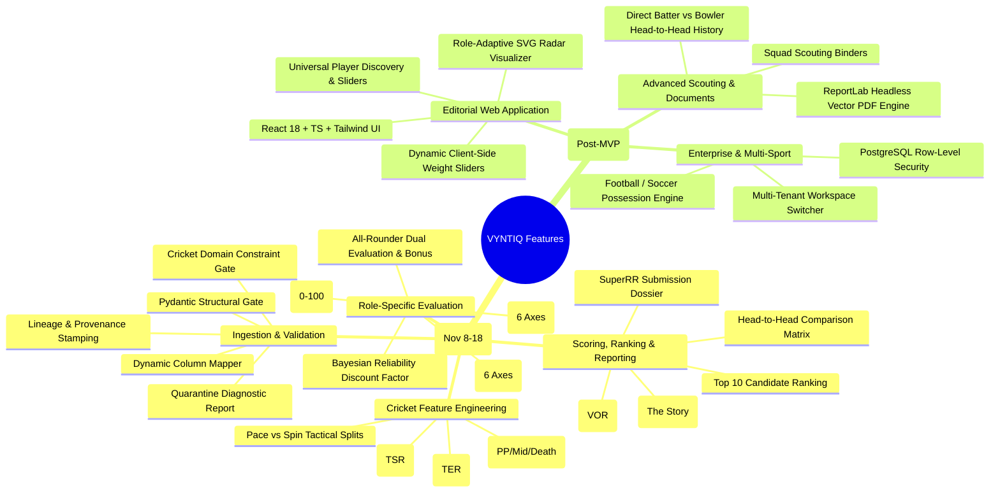

# VYNTIQ — Feature Map & Prioritization Matrix

**Document Reference:** FEAT-VYNTIQ-002  
**Document Version:** 2.0.0 (Post-Architecture Review & Competition MVP Alignment)  
**Status:** Approved Architectural Baseline  

---

## 1. Two-Track Feature Architecture



---

## 2. Granular Module Specifications

### Module 1: Flexible Data Ingestion & Integrity Gate
| Feature ID | Feature Name | Track | Inputs | Computational Mechanism | Primary Output |
| :--- | :--- | :--- | :--- | :--- | :--- |
| **F-ING-01** | Multi-Format File Ingest | **Track A (MVP)** | CSV / JSON file upload | Stream parser with UTF-8 encoding verification | Parsed raw records |
| **F-ING-02** | Schema & Header Inspector | **Track A (MVP)** | Raw file headers | Fuzzy token matching against canonical dictionary | Proposed column mapping |
| **F-ING-03** | Structural Validation Gate | **Track A (MVP)** | Mapped records | Pydantic v2 strict type and boundary checking | Structurally valid records |
| **F-ING-04** | Cricket Domain Integrity Gate | **Track A (MVP)** | Delivery records | Sequence check ($0.1 \dots 19.6$), run reconciliation, legal ball verification | Domain-verified deliveries |
| **F-ING-05** | Quarantine Logger | **Track A (MVP)** | Corrupted records | Error serializer capturing line number, field, and violation | Diagnostic audit log |
| **F-ING-06** | Lineage & Origin Stamping | **Track A (MVP)** | Validated dataset | SHA-256 file hashing + `origin_type` assignment | Tagged workspace dataset |
| **F-ING-07** | UI Column Mapping Visualizer | **Track B (Full)** | Unmapped headers | Interactive React drag-and-drop column mapping modal | Confirmed custom mapping |

### Module 2: Cricket Feature Engineering & Contextual Metrics
| Feature ID | Feature Name | Track | Inputs | Computational Mechanism | Primary Output |
| :--- | :--- | :--- | :--- | :--- | :--- |
| **F-ENG-01** | Match-Phase Splitting | **Track A (MVP)** | Delivery over number | Partitioning into Powerplay (1–6), Middle (7–15), Death (16–20) | Phase-tagged deliveries |
| **F-ENG-02** | Standard Ball-by-Ball Metrics | **Track A (MVP)** | Deliveries per player | Vectorized aggregation of runs, balls, boundaries, wickets, dots | Core rate statistics (SR, Econ, Dot %) |
| **F-ENG-03** | True Strike Rate (TSR) | **Track A (MVP)** | Batter balls, venue, phase | Phase-specific actual SR minus phase/venue baseline SR | $\text{TSR} \in (-\infty, +\infty)$ |
| **F-ENG-04** | True Economy Rate (TER) | **Track A (MVP)** | Bowler balls, venue, phase | Phase-specific baseline economy minus bowler actual economy | $\text{TER} \in (-\infty, +\infty)$ |
| **F-ENG-05** | Tactical Splits (Pace vs. Spin)| **Track A (MVP)** | Bowler bowling style | Delivery aggregation grouped by Pace vs. Spin categories | Matchup efficiency ratios |
| **F-ENG-06** | Tracking Extensions (Pitch Maps)| **Track B (Ext)** | Coordinate telemetry | Spatial kernel density estimation | Wagon wheels & pitch maps *(optional)* |

### Module 3: Role-Specific Evaluation & Normalization Engine
| Feature ID | Feature Name | Track | Inputs | Computational Mechanism | Primary Output |
| :--- | :--- | :--- | :--- | :--- | :--- |
| **F-EVL-01** | Role Archetype Classifier | **Track A (MVP)** | Career phase distributions | Threshold classification into Finisher, Anchor, Enforcer, Death Bowler | Player Role Archetype |
| **F-EVL-02** | Batting Dimension Engine | **Track A (MVP)** | Batter feature vectors | 6 dimensions: TSR, Boundary %, Balls/Dismissal, Dot %, Phase, Matchup | Batting score vector ($Z_{bat}$) |
| **F-EVL-03** | Bowling Dimension Engine | **Track A (MVP)** | Bowler feature vectors | 6 dimensions: TER, Strike Rate, Dot %, Boundary Supp., Phase, Discipline | Bowling score vector ($Z_{bowl}$) |
| **F-EVL-04** | All-Rounder Composite Engine | **Track A (MVP)** | Bat & Bowl vectors | Dual-discipline weighted sum + Role Balance / Dual-Utility Bonus | All-Rounder score ($Z_{ar}$) |
| **F-EVL-05** | ECDF Empirical Normalization | **Track A (MVP)** | Metric values per cohort | Percentile rank mapping ($0–100$) with directional inversion | Standardized dimension scores |
| **F-EVL-06** | Bayesian Reliability Discount | **Track A (MVP)** | Sample size $N$ vs $N_{full}$ | Sigmoidal/linear confidence discounting factor $C \in (0, 1]$ | Reliability multiplier $C$ |

### Module 4: Scoring, Ranking & Explainability Engine
| Feature ID | Feature Name | Track | Inputs | Computational Mechanism | Primary Output |
| :--- | :--- | :--- | :--- | :--- | :--- |
| **F-SCR-01** | VYNTIQ Overall Rating (VOR) | **Track A (MVP)** | Normalized scores & weights | $VOR = C \times \sum w_i Z_i$ using configurable role presets | Composite score ($0–100$) & Tier |
| **F-SCR-02** | Explainability Attribution Card | **Track A (MVP)** | Final score & dimension deltas | Feature attribution decomposing top 2 strengths and top 2 drag factors | "The Story Behind the Metric" |
| **F-SCR-03** | SuperRR Top 10 Ranker | **Track A (MVP)** | Candidate pool scores | Multi-factor sort: VOR desc, Confidence desc, Role suitability | Ranked Top 10 Candidate Roster |
| **F-SCR-04** | Dynamic Weight Customization | **Track B (Full)** | Slider inputs | Vectorized client-side re-weighting ($\vec{W} \cdot \vec{Z}$) | Real-time leaderboard re-sort |

### Module 5: Comparison, Shortlists & Reporting
| Feature ID | Feature Name | Track | Inputs | Computational Mechanism | Primary Output |
| :--- | :--- | :--- | :--- | :--- | :--- |
| **F-REP-01** | Head-to-Head Matrix | **Track A (MVP)** | 2–4 Player IDs | Columnar alignment with delta indicators ($+\Delta / -\Delta$) | Comparative performance grid |
| **F-REP-02** | SuperRR Submission Report | **Track A (MVP)** | Top 10 candidates & audit logs | Formatted analytical report with provenance data and tactical fit | Audit-ready submission document |
| **F-REP-03** | Role-Adaptive Radar Visualizer | **Track B (Full)** | Player dimension scores | Dynamic polygon canvas adapting vertices to role archetype | Interactive multi-axis radar |
| **F-REP-04** | Headless Vector PDF Dossier | **Track B (Full)** | Player / Shortlist ID | ReportLab programmatic vector compilation pipeline | Print-ready PDF scouting book |

---

## 3. Prioritization Matrix: Track A vs. Track B

```
                        CRITICAL PATH (Track A: Competition MVP)
                       ─────────────────────────────────────────
  High Impact          • Flexible Ingestion & Header Inspector (F-ING-01/02)
  & Essential          • Two-Tiered Validation & Quarantine (F-ING-03/04/05)
  for Nov 18           • Phase-of-Play & True Metrics (F-ENG-01/03/04)
  Submission           • Role-Specific Batting/Bowling Dimensions (F-EVL-02/03)
                       • ECDF Normalization & Reliability Shrinkage (F-EVL-05/06)
                       • VYNTIQ Overall Rating & Top 10 Ranker (F-SCR-01/03)
                       • Explainable Attribution Cards (F-SCR-02)
                       • SuperRR Submission Report & Shortlist (F-REP-02)
                       ─────────────────────────────────────────
                       POST-MVP ENHANCEMENTS (Track B: Full Platform)
                       ─────────────────────────────────────────
  High Value,          • Editorial React 18 Web UI & Faceted Filter Sliders
  Post-Competition     • Role-Adaptive SVG/Canvas Radar Charts (F-REP-03)
  Roadmap              • Headless Vector PDF Generation Engine via ReportLab (F-REP-04)
                       • Interactive Dynamic Weight Customizer (F-SCR-04)
                       • Row-Level Security & Multi-Tenant Workspace Switcher
                       • Multi-Sport Domain Abstractions (Football, Basketball)
```

---

## 4. Definition of Done (DoD)

### For Track A (Competition MVP) Features:
1. **Mathematical Accuracy:** Metric formulas match definitions in `SCORING_METHODOLOGY.md` exactly, verified by deterministic unit tests.
2. **Schema Resilience:** Ingestion successfully handles field order changes and whitespace without crashing.
3. **Quarantine Auditability:** Quarantined rows produce line-by-line diagnostic entries.
4. **Zero Sample Size Hallucination:** Every rating includes sample count ($N$) and confidence factor ($C$).
5. **Reproducibility:** Re-running the pipeline on identical input data produces identical scores down to 4 decimal places.

### For Track B (Full Platform) Features:
1. **Design System Adherence:** 100% compliance with `DESIGN_SYSTEM.md` editorial tokens.
2. **Performance SLA:** Sub-200ms API response time (p95) for indexed player queries.
3. **Cross-Browser & Vector Quality:** Crisp rendering on desktop/tablet, and vector-clean PDF printouts.
