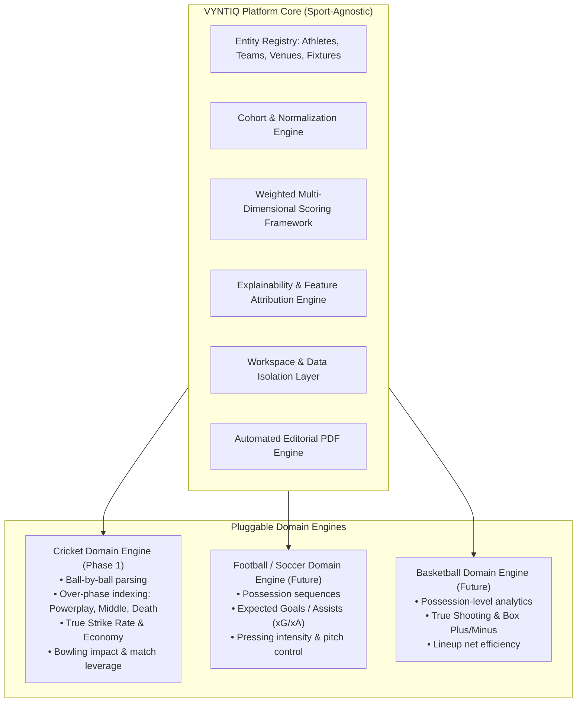

# VYNTIQ — Product Vision & Strategic Foundation

**Product Name:** VYNTIQ  
**Category:** Sports Intelligence Platform  
**Tagline:** "Every Metric Tells a Story."  
**Document Version:** 1.0.0  
**Status:** Approved Architectural Baseline  

---

## 1. Executive Summary

VYNTIQ is an enterprise-grade sports intelligence and scouting platform designed to bridge the gap between raw match data and high-stakes recruitment decisions. Built on the core belief that "Every Metric Tells a Story," VYNTIQ transforms granular play-by-play statistics into explainable, contextual, and decision-ready intelligence.

While the modern sports ecosystem produces massive amounts of ball-by-ball and event-level tracking data, sports organizations, scouts, and analysts struggle with two recurring failures in existing tooling:
1. **The "Black Box" Problem:** Modern AI/ML tools offer predictive rankings without transparent mathematical reasoning, preventing coaching staff and executives from trusting recommendations.
2. **The "Stat Sheet" Problem:** Traditional dashboards display uncontextualized aggregate statistics (e.g., batting averages, strike rates) that fail to adjust for match phases, opposition quality, conditions, or role-specific execution.

VYNTIQ addresses both failures by introducing a **context-aware, multi-dimensional evaluation engine** where every composite score and recommendation is fully deconstructed, transparently weighted, and traceable back to the raw event data.

---

## 2. Core Positioning & Brand Identity

### 2.1 Brand Ethos & Personality
- **Analytical & Rigorous:** No hand-waving or superficial metrics. Every metric has a rigorous definition, explicit normalization, and clear analytical purpose.
- **Premium Editorial Quality:** A visual and analytical tone reminiscent of high-end analytical periodicals and professional sports operations rooms—not noisy gamer UIs or generic SaaS templates.
- **Explainable & Trustworthy:** We reject opaque predictions. Every grade, tier, and recommendation comes with traceable data lineage and feature attribution.
- **Modular & Sport-Agnostic Core:** The platform architecture treats sports as pluggable domain engines over an invariant core of entity resolution, cohort normalization, evaluation modeling, and workspace management.

### 2.2 Neutrality & Workspace Isolation
VYNTIQ is an **independent platform product**. Its first operational deployment is the **SuperRR Selector Season 2** competition workspace (evaluating talent for the Rajasthan Royals franchise ecosystem).

> **Architectural Non-Negotiable:**  
> The platform identity must never be coupled to Rajasthan Royals or any individual franchise. Rajasthan Royals operates strictly as an isolated **Competition Workspace** tenant within VYNTIQ. All branding, visual identities, logos, color schemes, and proprietary heuristics of a client remain contained within their respective workspace context. VYNTIQ maintains its own sovereign editorial brand identity.

---

## 3. Target Personas & User Journeys

| Persona | Primary Goal | Key Pain Points | VYNTIQ Value Proposition |
| :--- | :--- | :--- | :--- |
| **Lead Scout / Talent Hunter** | Identify undervalued, high-ceiling domestic and international talent for specific squad gaps. | Sifting through thousands of unformatted player profiles; lack of phase-specific context; subjective scouting biases. | Dynamic role-based filtering, cohort benchmarking, radar profile matching, and shortlist exports. |
| **Head of Performance / Technical Analyst** | Evaluate opposition matchups, diagnose tactical efficiencies, and benchmark squad depth. | Inflexible metrics; inability to adjust for league strength, match phase, or pressure; siloed tools. | Granular ball-by-ball feature extraction, custom metric weighting, interactive player comparison matrix. |
| **Team Director / GM / C-Suite** | Make high-value auction and recruitment decisions with quantifiable risk profiles. | Black-box predictive models that coaching staff reject; inability to defend picks to franchise ownership. | Explainable recommendation summaries, automated audit-ready PDF scouting dossiers, transparent risk-reward ratings. |
| **Competition Evaluator (e.g., SuperRR)** | Review candidate submissions, assess scouting rationale, and compare team compositions. | Inconsistent data formats; unverified claims; static spreadsheets lacking interactive drill-down. | Dedicated workspace sandbox, verified dataset ingestion, standardized scoring rubric, automated candidate report generation. |

---

## 4. Multi-Sport Evolution Roadmap

VYNTIQ is architected from Day 1 as an **abstract multi-sport engine**. While Cricket is the initial domain implementation (driven by the depth and richness of ball-by-ball event structures), the platform core abstracts entities into four invariant primitives:

### 4.1 Abstraction Strategy
- **Time/Event Abstraction:** Instead of hardcoding "overs and deliveries", the core ingestion pipeline processes atomic `Events` within `Matches`, characterized by `TemporalPhase` (e.g., Over 1–6 vs. Minutes 1–15 vs. Q1), `State` (score, balls remaining, win probability), and `ActorInvolvement` (striker, bowler, fielder).
- **Metric Abstraction:** All aggregate metrics feed into a normalized `MetricDimension` vector (0.0 to 100.0 percentile score relative to an explicit baseline cohort).
- **Role Archetypes:** Instead of hardcoded player classifications, roles are defined via multidimensional skill clusters (e.g., Cricket: *Death Overs Finisher*, *Powerplay Enforcer*, *Spin Choke Specialist*).

---

## 5. Strategic Differentiators

1. **Zero Black-Box Scoring:** Every composite index (e.g., *Player Value Rating*, *Clutch Factor*, *Versatility Index*) exposes its full calculation tree down to underlying sub-metrics and event-level samples.
2. **Phase-of-Play Contextualization:** Raw averages deceive. VYNTIQ evaluates performance indexed against phase difficulty, pitch type, match leverage, and opponent quality.
3. **Dual Data Lineage (Historical vs. Competition):** Distinct boundaries between canonical historical multi-year records and isolated, user-uploaded competition or tournament datasets.
4. **Editorial-Grade Output:** Rather than messy browser printouts, VYNTIQ compiles boardroom-ready, typography-curated vector PDF dossiers via a headless ReportLab compilation pipeline.

---

## 6. Ethical AI, Fairness & Anti-Bias Framework

- **Sample Size Thresholds:** Strict suppression and flagging of micro-sample statistical outliers (e.g., strike rate of 250 across only 12 balls faced is flagged with high confidence intervals).
- **Era and League Normalization:** Metrics across different leagues (IPL, BBL, domestic T20, international) are normalized against competition-specific baselines to prevent misleading flat comparisons.
- **Transparency Mandate:** If an algorithm penalizes a player's rating, the interface must explicitly state which metric dimension contributed negatively and the empirical distribution of that metric across the peer cohort.

