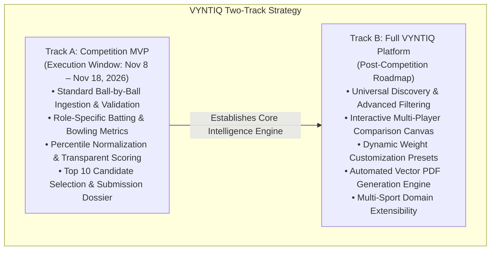
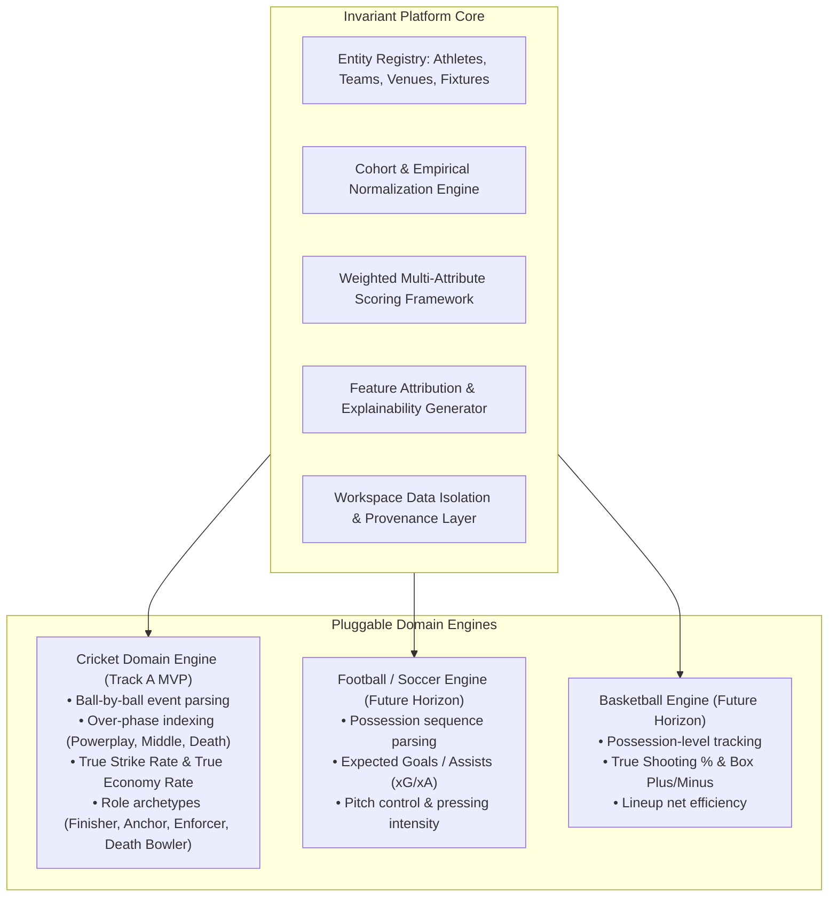

# VYNTIQ — Product Vision & Strategic Foundation

**Product Name:** VYNTIQ  
**Category:** Sports Intelligence Platform  
**Tagline:** "Every Metric Tells a Story."  
**Document Version:** 2.0.0 (Post-Architecture Review & Competition MVP Alignment)  
**Status:** Approved Architectural Baseline  

---

## 1. Executive Summary

VYNTIQ is an independent, premium sports intelligence and scouting platform designed to bridge the gap between raw match data and high-stakes recruitment decisions. Built on the core belief that **"Every Metric Tells a Story,"** VYNTIQ transforms granular play-by-play statistics into explainable, contextual, and decision-ready intelligence.

While the modern sports ecosystem produces massive amounts of event-level data, sports organizations, scouts, and analysts struggle with two recurring failures in existing tooling:
1. **The "Black Box" Problem:** Predictive tools offer rankings without transparent mathematical reasoning, preventing coaching staff and executives from trusting recommendations.
2. **The "Stat Sheet" Problem:** Traditional dashboards display uncontextualized aggregate statistics (e.g., career batting averages, overall strike rates) that fail to adjust for match phases, conditions, sample size reliability, or role-specific execution.

VYNTIQ solves both problems through a **context-aware, multi-dimensional evaluation engine** where every composite score and recommendation is deconstructed, transparently weighted, and traceable back to verified event-level data.

---

## 2. Core Positioning & Brand Identity

### 2.1 Brand Ethos & Personality
* **Analytical & Rigorous:** No hand-waving or superficial vanity metrics. Every metric has a mathematically sound formula, explicit cohort normalization, and defined directionality.
* **Premium Editorial Quality:** A visual and analytical tone reminiscent of high-end analytical periodicals and professional sports operations rooms—not noisy gamer UIs or generic SaaS dashboard templates.
* **Explainable & Trustworthy:** We reject opaque predictions. Every grade, tier, and recommendation comes with traceable data lineage, confidence indicators, and factor attribution.
* **Modular Architecture:** The platform core abstracts entities, cohorts, and evaluation pipelines, allowing sport-specific engines (starting with Cricket) to function as pluggable modules.

### 2.2 Sovereign Platform Identity & Workspace Tenancy
VYNTIQ is an **independent, sovereign platform product**. Its initial operational deployment is the **SuperRR Selector Season 2** competition workspace (evaluating talent for the Rajasthan Royals franchise ecosystem).

> [!IMPORTANT]
> **Architectural Non-Negotiable: Brand Separation**  
> The platform identity must never be coupled to Rajasthan Royals or any individual franchise. Rajasthan Royals operates strictly as an isolated **Competition Workspace** tenant within VYNTIQ (`workspace_super_rr_s2`). All branding, visual identities, logos, color schemes, and proprietary heuristics of a client remain contained within their respective workspace context. VYNTIQ maintains its own sovereign editorial brand identity across all views.

---

## 3. Two-Track Development Strategy

To balance the immediate real-world deadline of the competition with the long-term integrity of the product, VYNTIQ operates on two distinct development tracks:

### 3.1 Track A — Competition MVP (SuperRR Selector Season 2)
* **Target Constraint:** Fixed deadline of **November 18, 2026**. Official data release: **November 8, 2026, at 6:00 PM IST**.
* **Primary Objective:** Build an analytically rigorous, fully tested cricket evaluation engine capable of ingesting the official competition dataset, resolving player identities, computing phase-of-play metrics, scoring candidates across role-specific dimensions, and producing an audit-ready Top 10 candidate recommendation report.
* **Scope Discipline:** Focus strictly on what is required to produce a winning, mathematically defensible scouting submission. Do not build speculative features before the analytical core is tested and verified.

### 3.2 Track B — Full VYNTIQ Platform (Long-Term Vision)
* **Primary Objective:** Expand the competition-tested engine into an enterprise-grade, multi-workspace SaaS platform supporting universal player discovery, interactive comparison canvases, custom shortlist workflows, headless vector PDF generation, and multi-sport extensibility.

---

## 4. Target Personas & Value Proposition

| Persona | Primary Goal | Core Pain Points | VYNTIQ Value Proposition | Track Alignment |
| :--- | :--- | :--- | :--- | :--- |
| **Competition Scout / Analyst (SuperRR)** | Identify the Top 10 undervalued prospects for the franchise from competition data. | Inconsistent data formats, short evaluation window, risk of sample-size bias. | Automated validation, role-specific dimensional scoring, traceable ranking, and audit-ready report generation. | **Track A (MVP)** |
| **Franchise Director of Cricket / GM** | Make high-stakes recruitment and auction decisions with quantifiable risk profiles. | Black-box predictive models coaching staff reject; inability to defend picks to ownership. | Explainable attribution cards ("The Story Behind the Metric"), confidence intervals, and risk-reward profiles. | **Track A & B** |
| **Lead Technical Analyst** | Benchmark squad depth, evaluate phase-specific tactics, and model replacement options. | Inflexible metrics, lack of phase-of-play splits, unadjusted raw statistics. | True Strike Rate (TSR), True Economy Rate (TER), and role-specific radar gap analysis. | **Track B (Full Platform)** |
| **Multi-Sport Scout (Future)** | Evaluate athletes across disciplines using unified scouting workflows. | Disparate software across sports, inconsistent evaluation rubrics. | Unified platform core with pluggable sport domain engines. | **Track B (Future)** |

---

## 5. Multi-Sport Abstraction Strategy

VYNTIQ is designed with a sport-agnostic core. The core system defines invariant primitives that apply across team sports, while specific sports are implemented as pluggable domain engines:

---

## 6. Strategic Differentiators

1. **Zero Black-Box Scoring:** Every composite index exposes its exact mathematical formula, feature weights, and raw underlying event counts.
2. **Phase-of-Play Contextualization:** Raw averages deceive. VYNTIQ evaluates performance indexed against phase difficulty (Powerplay, Middle, Death) and scoring environment baselines.
3. **Rigorous Sample-Size Discipline:** Micro-sample distortions are actively mitigated through explicit qualification thresholds and Bayesian reliability discounting.
4. **Data Provenance & Dual Lineage:** Clear separation between verified historical records and competition-provided datasets, ensuring evaluation findings are reproducible and auditable.

---

## 7. Ethical AI, Fairness & Anti-Bias Framework

* **Sample-Size Transparency:** Never present a high-rate metric from a small sample (e.g., SR 240 across 10 balls) without a prominent low-sample warning badge and confidence interval.
* **Role-Appropriate Evaluation:** Batters are evaluated on batting metrics, bowlers on bowling metrics. Cross-discipline metrics are never conflated.
* **Audit Trail Mandate:** Any stakeholder must be able to click on a player's rating and view the exact deliveries and mathematical steps that produced that score.
