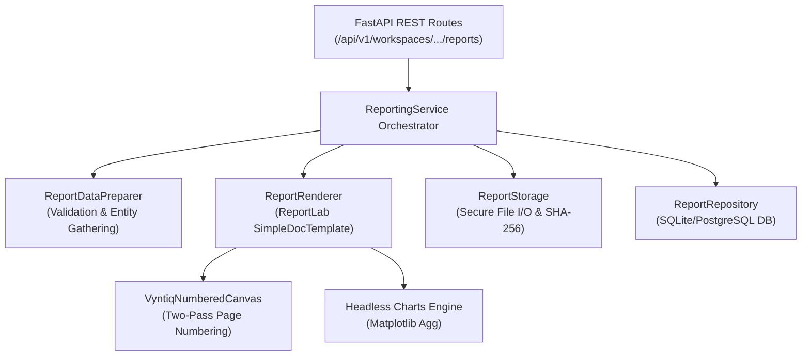

# VYNTIQ — PDF Reporting & Export Engine Specification

**Document Version:** 1.0.0  
**Status:** Approved & Implemented (Prompt 12)  
**Parent Platform:** VYNTIQ Sports Intelligence ("Every Metric Tells a Story.")  
**Design Tokens Compliance:** Dark Ground (`#111318`), Accent Magenta (`#D62978`), Accent Lime (`#B9D66C`), Background Ivory (`#F1EFEA`)

---

## 1. Executive Summary & Objective

The **PDF Reports & Export Engine** provides professional, print-ready, reproducible vector PDF report generation for VYNTIQ. Reports are compiled dynamically using ReportLab 4.5.1 and headless Matplotlib 3.10.8 (`Agg` backend), providing institutional-grade documents for franchise executives, talent scouts, coaching staffs, and competition committees.

### Strict Architectural Boundaries & Principles
1. **Zero Client/PDF Recomputations:** The PDF export layer never calculates, recalculates, or approximates VOR scores, percentiles, or metrics. It strictly consumes verified, immutable outputs from the analytics, evaluation, scoring, explainability, comparison, and shortlisting engines.
2. **Immutable Audit Lineage:** Every generated report receives an immutable database record (`GeneratedReport`) containing its unique report ID, SHA-256 content digest, file size, target workspace/player, scoring run reference, dataset lineage, and timestamp.
3. **Enterprise Privacy Safeguards:** Internal reviewer notes and scout feedback are strictly suppressed by default unless the request explicitly passes `include_reviewer_notes=True`.
4. **Statistical Safeguard Enforcement:** Cross-role comparisons trigger conspicuous statistical advisory warnings and suppress invalid cross-role VOR leadership badges.
5. **Filesystem Isolation:** Internal file paths are never returned over public REST APIs; reports are streamed safely using standardized `FileResponse` attachments with cryptographically sanitized filenames.

---

## 2. Canonical Report Types

The reporting engine supports four specialized vector PDF document templates:

```
+---------------------------------------------------------------------------------------+
|                                    VYNTIQ REPORTS                                     |
+---------------------------+---------------------------+-------------------------------+
| Report Type               | Scope                     | Key Sections                  |
+---------------------------+---------------------------+-------------------------------+
| COMPETITION_OVERVIEW      | Workspace Context         | Workspace metadata, rules,    |
|                           |                           | dataset summary, candidate    |
|                           |                           | pool, active shortlist        |
+---------------------------+---------------------------+-------------------------------+
| INDIVIDUAL_PLAYER         | Single Athlete            | Bio header, VOR card, radar   |
|                           |                           | polygon, dimensions, factor   |
|                           |                           | attribution, audit breakdown  |
+---------------------------+---------------------------+-------------------------------+
| PLAYER_COMPARISON         | 2 to 5 Candidates         | Cross-role advisory banner,   |
|                           |                           | side-by-side VOR, dimension   |
|                           |                           | deltas, discipline metrics    |
+---------------------------+---------------------------+-------------------------------+
| SHORTLIST                 | Workspace Shortlist       | Roster composition chart,     |
|                           |                           | leaderboard, mini-dossiers,   |
|                           |                           | exclusion audit, notes toggle |
+---------------------------+---------------------------+-------------------------------+
```

### Type A: Competition Overview Report (`COMPETITION_OVERVIEW`)
- **Header:** Workspace title, competition edition, sport code, active configuration version.
- **Section 1: Workspace & Tournament Context:** Key metadata including workspace ID, season, description, and status badge.
- **Section 2: Competition Rules & Thresholds:** Age windows, cutoff dates, minimum balls faced, and minimum overs bowled.
- **Section 3: Dataset Lineage & Integrity:** Validated source filename, record counts, deliveries, matches, and SHA-256 digest.
- **Section 4: Candidate Pool Distribution:** Total evaluated players, quarantined record count, and role breakdown summary.
- **Section 5: Active Shortlist Summary:** Top candidates preview with target squad size.

### Type B: Individual Player Evaluation Dossier (`INDIVIDUAL_PLAYER`)
- **Header:** Candidate name, primary role badge, biographical profile (nationality, batting hand, bowling style).
- **Section 1: Executive VOR Scorecard:** Value Over Replacement (VOR) rating, Raw Composite Score, Bayesian Reliability Factor \(C(N)\), and Reliability Grade.
- **Section 2: Match Workloads & Sample Counts:** Innings, balls faced, dismissals, legal deliveries bowled, and sample adequacy status.
- **Section 3: Role Dimension Profile & Radar Polygon:** Side-by-side layout pairing a structured dimension percentiles table with a high-resolution polar radar chart.
- **Section 4: Factor Attribution & Explainability:** Narrative scout summary, top statistical strengths, drag factors, and mathematical reconciliation audit.

### Type C: Head-to-Head Candidate Comparison Report (`PLAYER_COMPARISON`)
- **Cross-Role Safeguard Banner:** Displayed prominently when comparing incompatible roles (e.g. specialist batter vs. specialist bowler). Suppresses false VOR leader badges and issues cross-role interpretation warnings.
- **Section 1: Head-to-Head Candidate Summary:** Side-by-side candidate cards highlighting VOR ratings and reliability factors.
- **Section 2: Evaluation Dimensions Delta Matrix:** Multi-candidate dimension table showing absolute score deltas relative to baseline and color-coded advantage markers.
- **Section 3: Discipline-Specific Performance Metrics:** Segmented batting and bowling tables with explicit directionality indicators (`Higher is better` vs. `Lower is better`).

### Type D: Candidate Shortlist & Scouting Dossier (`SHORTLIST`)
- **Header:** Shortlist title, competition edition, target squad size, status badge.
- **Section 1: Roster Composition & Distribution:** Role breakdown table paired with horizontal composition bar chart.
- **Section 2: Verified Candidate Leaderboard:** Ordered roster ranking with VOR scores, reliability factors, and review statuses.
- **Section 3: Candidate Mini-Dossiers:** Individual candidate summary blocks with scout notes (omitted if `include_reviewer_notes=False`).
- **Section 4: Excluded / Ineligible Candidates Audit:** Summary of candidates disqualified by eligibility rules with explicit reason strings (e.g., age cutoff, workload threshold).

---

## 3. Architecture & Engine Pipeline



### Module Breakdown
- `backend/app/services/reporting/styles.py`: Defines official VYNTIQ palette (`#111318`, `#D62978`, `#B9D66C`, `#F1EFEA`) and typography hierarchy using standard Helvetica/Helvetica-Bold fonts.
- `backend/app/services/reporting/canvas.py`: Implements `VyntiqNumberedCanvas`, intercepting page states during a two-pass rendering cycle to calculate total pages dynamically and print uniform header running banners and "Page X of Y" footers.
- `backend/app/services/reporting/charts.py`: Generates vector-ready PNG byte buffers using headless Matplotlib (`Agg` backend), ensuring thread-safe chart rendering for polar radar charts, grouped horizontal comparison charts, and roster composition bars.
- `backend/app/services/reporting/templates/`: Modular Flowable compilers for each of the 4 report types.
- `backend/app/services/reporting/data_preparer.py`: Performs strict entity validation across `WorkspaceService`, `ScoringService`, `ExplainabilityService`, and `WorkspaceRepository`.
- `backend/app/services/reporting/storage.py`: Generates path-safe filenames, resolves storage directories securely, prevents path traversal attacks, and computes SHA-256 cryptographic digests.
- `backend/app/services/reporting/service.py`: Orchestrates preparation, rendering, storage, and persistence into `GeneratedReport`.

---

## 4. REST API Reference

### Workspace-Scoped Endpoints

| Method | Endpoint | Description |
|---|---|---|
| `POST` | `/api/v1/workspaces/{workspace_id}/reports` | Generate a new PDF report within workspace context |
| `GET` | `/api/v1/workspaces/{workspace_id}/reports` | List all reports generated for the specified workspace |
| `GET` | `/api/v1/workspaces/{workspace_id}/reports/{report_id}` | Fetch metadata and audit record for a specific report |
| `GET` | `/api/v1/workspaces/{workspace_id}/reports/{report_id}/download` | Download report PDF file as an attachment |

### Standalone Endpoints

| Method | Endpoint | Description |
|---|---|---|
| `POST` | `/api/v1/reports` | Generate a standalone player dossier or comparison report |
| `GET` | `/api/v1/reports/{report_id}` | Fetch standalone report metadata |
| `GET` | `/api/v1/reports/{report_id}/download` | Download standalone report PDF |

### Sample Generation Request Payload
```json
{
  "report_type": "INDIVIDUAL_PLAYER",
  "player_id": "P_SANJU",
  "run_id": "run_2026_super_rr",
  "title": "Rajasthan Royals Talent Hunt — Sanju Samson Dossier",
  "include_reviewer_notes": false
}
```

### Sample Response Payload
```json
{
  "report_id": "rep_94c1a2f4e8b0",
  "workspace_id": "ws_super_rr_01",
  "report_type": "INDIVIDUAL_PLAYER",
  "title": "Rajasthan Royals Talent Hunt — Sanju Samson Dossier",
  "filename": "VYNTIQ_INDIVIDUAL_PLAYER_P_SANJU_20261108_092606.pdf",
  "file_size_bytes": 70890,
  "sha256_hash": "a4d8c9e1f2b3...",
  "dataset_reference": "IPL_HISTORICAL_2024",
  "generation_status": "COMPLETED",
  "created_at": "2026-11-08T09:26:06.124500Z",
  "download_url": "/api/v1/workspaces/ws_super_rr_01/reports/rep_94c1a2f4e8b0/download"
}
```

---

## 5. Security, Privacy & Integrity Controls

1. **Path Traversal Shield:** Filenames are generated deterministically using sanitized alphanumeric identifiers and timestamps. Input paths are resolved against `Settings.REPORTS_DIR`, and any path attempting traversal beyond the root is rejected with a 400 error.
2. **Reviewer Notes Confidentiality:** Reviewer notes (`reviewer_notes`) stored in candidate records are suppressed by default in exported PDF documents unless `include_reviewer_notes=True` is explicitly supplied in the request.
3. **Deterministic Page Numbering:** The two-pass `VyntiqNumberedCanvas` dynamically records page states, ensuring exact "Page X of Y" page counts regardless of table pagination or dynamic chart flow.
4. **Digest Verification:** Every generated PDF file is hashed with SHA-256 upon compilation. The digest is stored immutably in `generated_reports` for tamper detection and archival verification.
