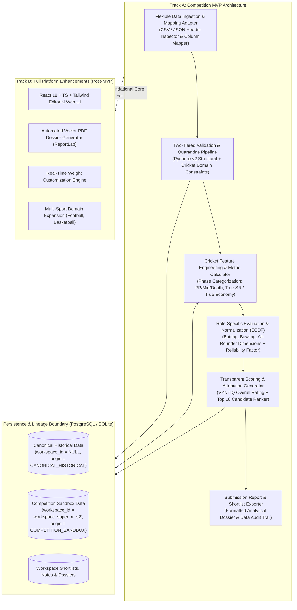
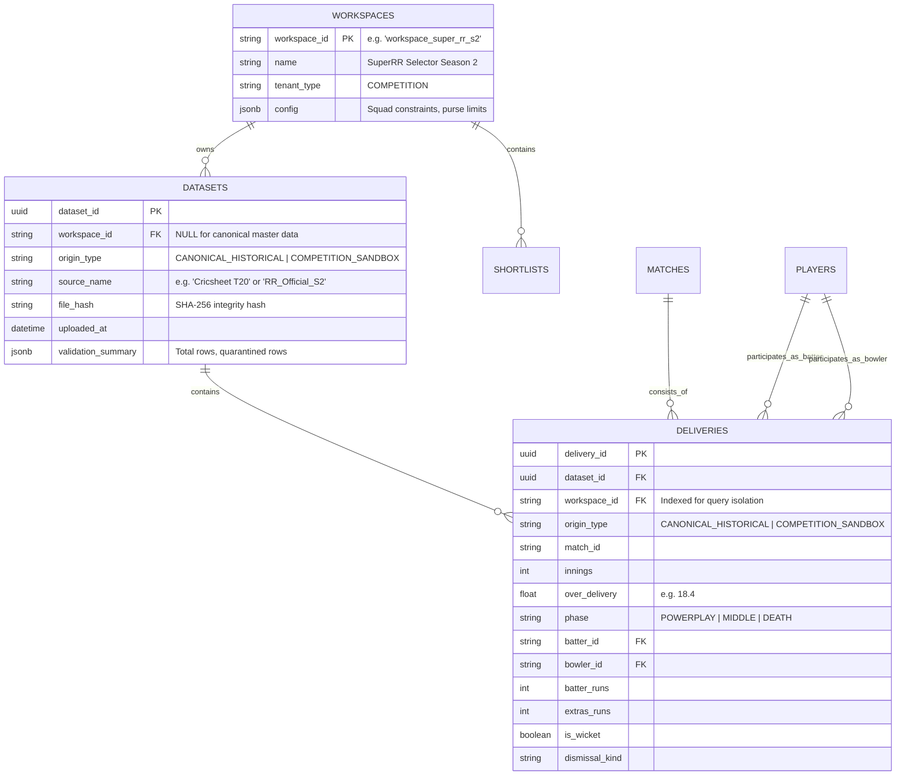
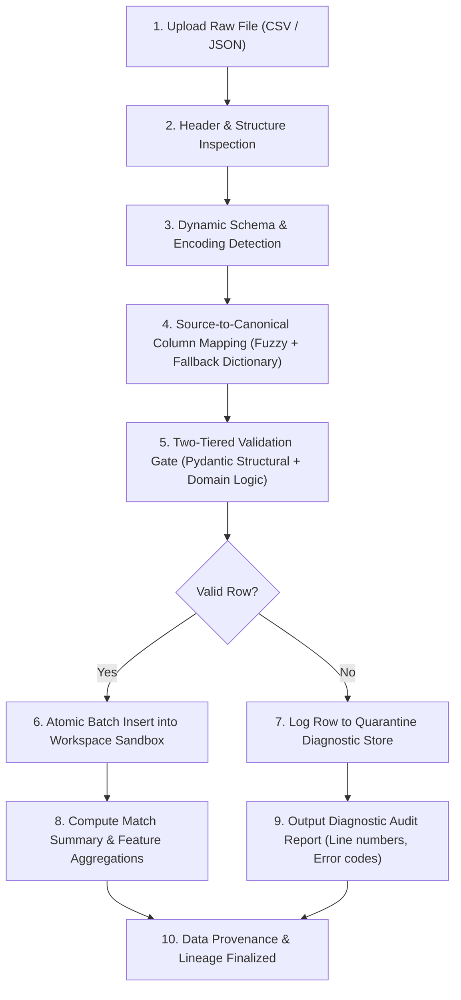
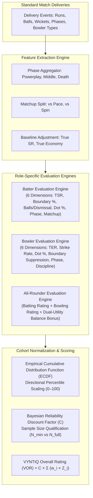

# VYNTIQ — System Architecture Blueprint

**Document Reference:** ARCH-VYNTIQ-002  
**Architecture Pattern:** Modular Monolith with Domain-Driven Core & Multi-Tenant Workspace Scoping  
**Document Version:** 2.0.0 (Post-Architecture Review & Competition MVP Alignment)  
**Status:** Approved Architectural Baseline  

---

## 1. Architectural Philosophy & Strategy

VYNTIQ is built on the philosophy of **architectural simplicity, mathematical transparency, and strict domain boundaries**. To ensure the platform can be reliably implemented by a focused development team within the real-world timeline of the **SuperRR Selector Season 2** competition (November 8–18, 2026), the system avoids premature distributed infrastructure in favor of a **well-factored modular monolith**.



---

## 2. Workspace Isolation & Data Lineage Strategy

### 2.1 Evaluation of Multi-Tenancy Approaches
During the architecture review, three strategies for workspace isolation were rigorously evaluated:

| Isolation Strategy | Operational Complexity | Cross-Cohort Query Efficiency | Migration Maintenance | Recommendation for VYNTIQ |
| :--- | :--- | :--- | :--- | :--- |
| **Option 1: PostgreSQL Schema-per-Workspace** (`schema_canonical`, `schema_super_rr`) | **Very High:** Requires dynamic DDL, runtime schema switching, and duplicate Alembic migrations. | **Poor:** Cross-schema joins (e.g. comparing competition players against historical baselines) are cumbersome. | **High Risk:** High likelihood of schema drift between workspaces. | **REJECTED** |
| **Option 2: Row-Level Security (RLS)** (PostgreSQL native RLS policies) | **Medium-High:** Requires database-level session variables (`SET LOCAL app.current_workspace`) on pooled connections. | **Moderate:** Can cause subtle query planner optimization failures during large analytical group-bys. | **Moderate:** Requires strict DB role management and complex testing. | **POSTPONED TO TRACK B** |
| **Option 3: Shared Tables with `workspace_id` + `dataset_origin`** | **Low:** Clean, standard relational foreign key design. Fully testable in-memory and on standard databases. | **Optimal:** Instant single-query joins between workspace datasets and canonical baseline benchmarks. | **Low:** Single Alembic migration track; zero dynamic DDL. | **ADOPTED FOR VERSION 1.0** |

### 2.2 Selected Model: Scoped Shared Tables with Origin Provenance
To ensure immediate reliability for the competition MVP while establishing a robust foundation for Track B, VYNTIQ implements **Shared Tables with Application-Level Workspace Scoping**:



### 2.3 Guaranteeing Data Lineage & Preventing Cross-Workspace Leakage
1. **Canonical Master Baseline Isolation:**  
   * Canonical multi-year match data carries `workspace_id = NULL` and `origin_type = 'CANONICAL_HISTORICAL'`.
   * It is strictly read-only and accessible to all analytical queries as a benchmark reference.
2. **Competition Sandbox Scoping:**  
   * Uploaded datasets for the SuperRR competition are explicitly stamped with `workspace_id = 'workspace_super_rr_s2'` and `origin_type = 'COMPETITION_SANDBOX'`.
   * All mutations, shortlists, private scouting notes, and candidate rankings require a mandatory `workspace_id` predicate injected via the application layer (`Depends(get_current_workspace)`).
3. **Traceable Attribution:**  
   * Every computed score and recommendation card carries a provenance tag indicating whether it was computed from canonical historical data, competition data, or a blended cohort.

---

## 3. Adaptable Data Ingestion & Quarantine Pipeline

Because the official SuperRR dataset schema will only be revealed upon release (November 8, 2026, 6:00 PM IST), VYNTIQ implements an **adaptable 10-step ingestion pipeline** to handle arbitrary column formats:



### Ingestion Validation Rules:
* **Over Sequence:** Deliveries within an innings must progress sequentially ($0.1 \dots 19.6$).
* **Run Accounting:** Total runs for a delivery must equal `batter_runs + extras_runs`.
* **Legal Deliveries:** Deliveries flagged as wides or no-balls do not advance the official over legal ball counter.
* **Dismissals:** Deliveries with `is_wicket = True` must specify `player_dismissed` and a valid dismissal kind.
* **Quarantine Guarantee:** Invalid rows never crash the ingestion run. They are isolated into a quarantined error manifest detailing the exact file name, line index, and constraint violation.

---

## 4. Role-Specific Player Evaluation Architecture

To resolve historical contradictions where batters and bowlers were inappropriately measured against identical axes, VYNTIQ establishes **distinct, role-adaptive evaluation engines**:



---

## 5. Technical Stack & Architectural Constraints

```
┌────────────────────────────────────────────────────────────────────────┐
│ VYNTIQ MODULAR MONOLITH COMPONENT STACK                               │
├────────────────────────────────────────────────────────────────────────┤
│ Presentation Tier:                                                     │
│ • Track A: Formatted analytical dossiers, structured JSON, and CLI    │
│ • Track B: React 18, TypeScript, Tailwind CSS, Lucide React            │
├────────────────────────────────────────────────────────────────────────┤
│ Application & API Tier:                                                │
│ • Python 3.11+                                                         │
│ • FastAPI (Async ASGI framework, clean dependency injection)           │
│ • Pydantic v2 (High-throughput schema validation and serialization)    │
│ • Uvicorn (Production ASGI application server)                         │
├────────────────────────────────────────────────────────────────────────┤
│ Analytics & Feature Engineering Tier:                                  │
│ • Pandas 2.2+ (Vectorized delivery aggregation & phase splits)         │
│ • NumPy 1.26+ (Matrix operations, true rate deviations)                │
│ • SciPy 1.13+ (ECDF empirical normalization, Bayesian shrinkage)       │
├────────────────────────────────────────────────────────────────────────┤
│ Persistence Tier:                                                      │
│ • PostgreSQL 16+ (Target production database with partitioned tables)  │
│ • SQLite (Dev/testing database engine with identical schema parity)    │
│ • SQLAlchemy 2.0+ (Modern typed async ORM & query builder)             │
│ • Alembic (Deterministic database schema migration harness)            │
├────────────────────────────────────────────────────────────────────────┤
│ Reporting Tier:                                                        │
│ • Track A: Markdown/HTML Dossier Engine with embedded data tables      │
│ • Track B: Python ReportLab 4.2+ (Headless vector PDF compiler)        │
└────────────────────────────────────────────────────────────────────────┘
```

---

## 6. Architectural Risks & Mitigations

| Risk | Impact | Architectural Mitigation Strategy |
| :--- | :--- | :--- |
| **Unknown Competition Schema on Nov 8, 6 PM** | High | Implemented flexible column mapping adapter with runtime header inspection and interactive confirmation fallbacks. |
| **Small Sample Distortion in Tournament Play** | High | Applied strict qualification boundaries ($N_{min}$) and Bayesian shrinkage factor ($C$) to regress micro-sample outliers toward cohort medians. |
| **Tight 10-Day Competition Timeline** | Critical | Enforced strict Two-Track scope partitioning. Deferred non-essential UI, complex caching, and PDF microservices to Track B. |
| **Database Environment Variability** | Medium | Configured SQLAlchemy with dual database URL support: native SQLite for instant zero-dependency local dev/testing, and PostgreSQL 16 for production. |
| **Cross-Workspace Data Leakage** | Critical | Enforced mandatory `workspace_id` foreign keys on all non-canonical tables with centralized FastAPI dependency validation. |
