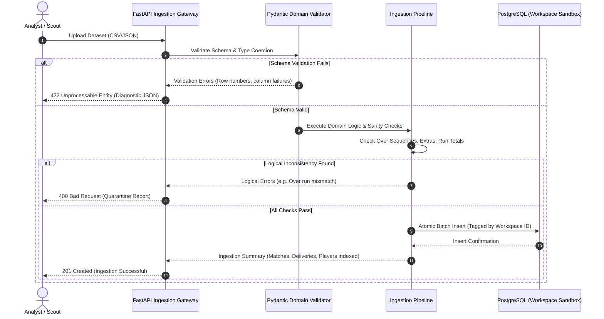
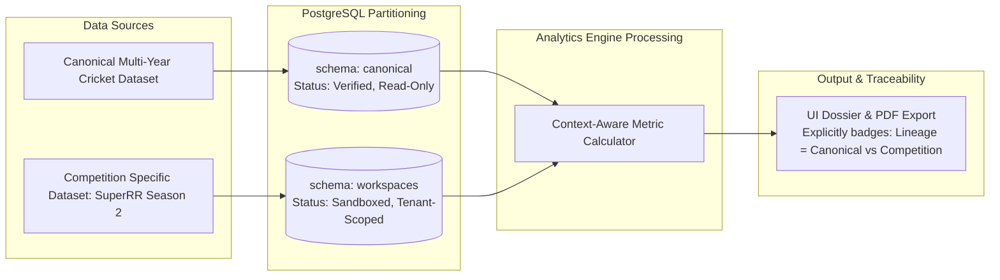

# VYNTIQ — System Architecture Blueprint

**Document Reference:** ARCH-VYNTIQ-001  
**Architecture Pattern:** Layered Modular Architecture / Clean Architecture with Domain-Driven Core  
**Document Version:** 1.0.0  
**Status:** Approved Architectural Baseline  

---

## 1. High-Level Architectural Topology

VYNTIQ is designed as a decoupled, layered platform where core mathematical intelligence, feature engineering, and reporting are completely separated from presentation and I/O delivery mechanisms.

```mermaid
graph TB
    subgraph ClientLayer ["1. Frontend Presentation Layer (React 18 + TS + Tailwind CSS)"]
        UI_Discovery[Player Discovery & Faceted Filters]
        UI_Profile[Player Deep-Dive Profile & Radar]
        UI_Comparison[Head-to-Head Comparison Matrix]
        UI_Shortlist[Scouting Shortlist & Boardroom View]
        UI_Workspace[Competition Workspace Switcher]
        UI_Ingest[Dataset Upload & Validation Inspector]
    end

    subgraph APILayer ["2. Backend API Layer (FastAPI + Async Gateway)"]
        API_Auth[Workspace & Identity Context Middleware]
        API_Routes[REST Endpoints / OpenAPI Contracts]
        API_Validators[Pydantic v2 Request/Response Serializers]
        API_Cache[In-Memory / Redis Result Cache Layer]
    end

    subgraph ServiceLayer ["3. Intelligence & Core Analytics Services"]
        ENG_Ingest[Data Ingestion & Quarantine Pipeline]
        ENG_Validation[Schema & Integrity Validation Engine]
        ENG_Processing[Vectorized Aggregation (Pandas / NumPy)]
        ENG_Feature[Feature Engineering & Contextual Metrics]
        ENG_Evaluation[Player Evaluation & Role Normalization Engine]
        ENG_Recommendation[Explainable Recommendation & Squad Fit Engine]
        ENG_Reporting[ReportLab Headless PDF Dossier Engine]
    end

    subgraph DomainLayer ["4. Domain Model & Sport Abstraction Layer"]
        DOM_Core[Abstract Sport Model: Entity, Event, Phase, Metric, Cohort]
        DOM_Cricket[Cricket Engine: Deliveries, Dismissals, Powerplay/Middle/Death, True SR/TER]
        DOM_Future[Extensible Plugin Slots: Football, Basketball]
    end

    subgraph PersistenceLayer ["5. Persistence & Storage Layer (PostgreSQL 16)"]
        DB_Canonical[(Canonical Historical Data: Matches, Deliveries, Players)]
        DB_Workspace[(Workspace Tenant Data: Submissions, Shortlists, Custom Scenarios)]
        DB_Reports[(Generated PDF Artifacts & Blob Storage)]
    end

    ClientLayer <-->|JSON / REST over HTTP/2| APILayer
    APILayer --> ServiceLayer
    ServiceLayer --> DomainLayer
    ServiceLayer <--> PersistenceLayer
```

---

## 2. Detailed Layer Specifications

### 2.1 Layer 1: Frontend Presentation Layer
* **Technology:** React 18, TypeScript (Strict Mode), Tailwind CSS.
* **Component Architecture:** Atomic design hierarchy (Atoms: Metric Badge, Tabular Cell; Molecules: Stat Trend Bar, Filter Pill; Organisms: Radar Comparison Canvas, Player Profile Header; Templates: Scouting Dossier View, Lead Scout Dashboard).
* **State Management:**
  * Server State: TanStack Query (React Query) for caching, background revalidation, and optimistic updates.
  * Local State: Lightweight React Context for UI state (e.g., active filters, drawer toggles, comparison selection).
* **Rendering Strategy:** Single Page Application (SPA) with responsive editorial layouts optimized for high-density information displays.

### 2.2 Layer 2: Backend API Layer
* **Technology:** Python 3.11+, FastAPI, Pydantic v2, Uvicorn.
* **Role:** Exposes versioned REST APIs (`/api/v1/...`), handles request authentication, validates incoming JSON/multipart payloads, injects workspace context via dependency injection (`Depends(get_current_workspace)`), and orchestrates service execution.
* **Key Endpoints:**
  * `GET /api/v1/players` — Search, query, filter, and rank players.
  * `GET /api/v1/players/{id}` — Full performance profile with phase splits.
  * `POST /api/v1/players/compare` — Multi-player comparative matrix.
  * `POST /api/v1/evaluations/calculate` — Dynamic re-weighting calculations.
  * `POST /api/v1/workspaces/{id}/ingest` — Upload and validate custom datasets.
  * `POST /api/v1/reports/pdf/{player_id}` — Compile and stream vector PDF scouting dossier.

### 2.3 Layer 3: Data Ingestion & Validation Layer
* **Design Pattern:** Pipeline / Filter Architecture with explicit quarantine stages.
* **Workflow:**
  1. **Upload Handler:** Accepts multipart `.csv` or `.json` containing match scorecards or delivery events.
  2. **Structure Verification:** Confirms required columns, encoding (UTF-8), and file checksum.
  3. **Domain Integrity Gate:** Runs validation checks:
     * Are overs in sequential order $[0.1 \dots 19.6]$?
     * Do runs, extras, and wicket counts add up to the innings total?
     * Are player names resolved or flagged as unknown entities?
  4. **Quarantine Execution:** If errors occur, the transaction is aborted; an actionable diagnostic report is returned detailing exact line numbers and failed constraints.



### 2.4 Layer 4: Data Processing & Feature Engineering Layer
* **Technology:** Vectorized Python (Pandas 2.2+, NumPy 1.26+).
* **Role:** Converts raw event sequences into rich analytical metrics.
* **Cricket Feature Extraction:**
  * Phase tagging: Assigns delivery to Powerplay, Middle, or Death.
  * Match leverage indexing: Computes match context based on target, current run rate, balls remaining, and wickets lost.
  * True Metric baseline computation: Pre-computes venue and phase averages to compute True Strike Rate (TSR) and True Economy Rate (TER).
  * Pressure metrics: Strike rate under high required run rate ($\ge 10.0$ RPO); Dot ball percentage when defending low totals.

### 2.5 Layer 5: Analytics & Player Evaluation Engine
* **Mathematical Framework:** Decile-based cohort normalization and multi-attribute utility theory (MAUT).
* **Computation Flow:**
  1. Group players by cohort (e.g., T20 matches 2022–2024, $\ge 150$ balls faced).
  2. Compute dimensional sub-metrics (Explosiveness, Stability, Spin Dominance, Pace Dominance, Death Execution, etc.).
  3. Transform raw metric values into standard percentile scores $S_i \in [0, 100]$ using empirical cumulative distribution functions (ECDF).
  4. Apply role-specific weight vector $W = [w_1, w_2, \dots, w_n]$ where $\sum w_i = 1.0$:
     $$\text{Overall Score} = \sum_{i=1}^n w_i \times S_i$$
  5. Assign categorical evaluation tiers:
     * **Tier 1 (90–100):** Franchise Cornerstone / Elite International Caliber
     * **Tier 2 (80–89):** High-Impact Specialist / Core XI Starter
     * **Tier 3 (70–79):** Reliable Tactical Asset / Primary Squad Depth
     * **Tier 4 (60–69):** Developing Talent / Niche Exploiter
     * **Tier 5 (< 60):** Unproven / High Risk Profile

### 2.6 Layer 6: Explainable Recommendation Engine
* **Core Principle:** No score without attribution.
* **Attribution Algorithm:**
  * For any player evaluation, calculate the delta of each metric dimension against the cohort median:
    $$\Delta_i = S_i - \text{Median}(S_{\text{cohort}})$$
  * Rank dimensions by absolute weighted impact: $I_i = w_i \times \Delta_i$.
  * Synthesize structured narrative explanations (e.g., *Key Strength: Elite Death Overs Strike Rate (+14.2% over cohort mean)*; *Key Vulnerability: High Dot Ball % against Wrist Spin (-8.1% vs cohort)*).

### 2.7 Layer 7: Automated PDF Reporting Engine
* **Technology:** Python ReportLab (Headless, native programmatic vector PDF generation).
* **Architecture:**
  * Custom `DocTemplate` with strictly enforced editorial page grid (margins, headers, footers).
  * Modular `Flowables` for tables, stat callouts, rating cards, and visual plots.
  * Plotly-to-Static image rendering pipeline (kaleido/headless rasterization) or direct vector drawing primitives for clean typography rendering.
  * Zero browser engine overhead (no Puppeteer/Chrome dependencies), ensuring high performance and deterministic server-side rendering.

### 2.8 Layer 8: Database & Persistence Layer
* **Technology:** PostgreSQL 16+.
* **Data Segregation Model:**
  * **Canonical Tables:** Global master entities (`players`, `matches`, `canonical_deliveries`, `venues`, `teams`).
  * **Workspace Tables:** Scoped by `workspace_id` (`workspace_datasets`, `workspace_deliveries`, `scouting_shortlists`, `scouting_notes`, `custom_weights`).
  * **Partitioning:** Partition `deliveries` tables by tournament/season year to maintain sub-second query performance as data scales to millions of rows.

---

## 3. Data Lineage & Workspace Sandboxing

To guarantee analytical validity during competitions (such as the SuperRR Selector Season 2), VYNTIQ enforces strict provenance boundaries:



1. **Origin Stamp:** Every delivery and scorecard row carries a cryptographic hash and an `origin_type` (`CANONICAL_HISTORICAL`, `WORKSPACE_UPLOAD`, `SYNTHETIC_TEST`).
2. **Analysis Context Switch:** Analysts can toggle between:
   * **Full Baseline:** Canonical historical records + competition records.
   * **Competition Isolated:** Exclusively analyzes performance inside the competition-provided dataset (essential for tournament-specific scouting rubrics).
3. **Traceability:** Every calculated metric exposes an API drill-down providing the exact set of `match_id` and `delivery_id` keys involved in the calculation.

---

## 4. Multi-Sport Abstraction Strategy

To prevent cricket from bleeding into generic platform abstractions, code is strictly partitioned:

```
src/
├── core/                        # SPORT-AGNOSTIC PLATFORM CORE
│   ├── entities/               # Athlete, Team, Venue, Match, Roster
│   ├── evaluation/             # Normalization, MAUT scoring, Radar models
│   ├── explainability/         # Feature attribution, narrative generators
│   ├── ingestion/              # Base validation, file parsers, quarantine
│   ├── reporting/              # Base PDF layout, typography, grid system
│   └── workspace/              # Multi-tenancy, permissions, workspace scopes
│
├── domains/                    # PLUGGABLE SPORT ENGINES
│   ├── cricket/                # CRICKET SPECIALIZATION
│   │   ├── models/             # Deliveries, OverPhases, DismissalTypes
│   │   ├── metrics/            # TrueSR, TrueEconomy, WicketThreat, DotBallPct
│   │   ├── roles/              # Finisher, Enforcer, Anchor, MysterySpin
│   │   └── templates/          # Cricket-specific PDF dossiers & radar layouts
│   └── football/               # FUTURE SPORT STUB
│       ├── models/
│       └── metrics/
│
└── api/                        # FASTAPI APPLICATION LAYER
    ├── routers/
    ├── dependencies/
    └── schemas/
```

---

## 5. Architectural Risks & Mitigations

| Risk | Severity | Impact | Architectural Mitigation Strategy |
| :--- | :--- | :--- | :--- |
| **Compute Bottleneck on Dynamic Re-weighting** | Medium | High CPU load if hundreds of players are re-scored on every slider move. | Calculate normalized dimension scores ($0–100$) once per cohort and store in fast memory cache. Real-time re-weighting is a simple dot product ($\vec{W} \cdot \vec{S}$) executed in sub-millisecond vectorized operations. |
| **Inconsistent Ball-by-Ball Data Formats** | High | Upload failures or corrupted statistical calculations during competitions. | Implement two-tiered validation: Pydantic structural validation followed by domain logic validation rules with automated error isolation. |
| **PDF Generation Memory Leaks** | Medium | Server crashes during large batch PDF exports of entire squads. | Use ReportLab stream recycling, avoid persistent canvas caching, and process batch exports sequentially or via background worker tasks. |
| **Workspace Data Contamination** | Critical | Leakage of proprietary competition scouting shortlists between workspaces. | Enforce workspace schema tenancy or mandatory workspace foreign keys verified at the API gateway middleware layer via JWT/session context. |
| **Micro-Sample Distortion** | High | Skewed ratings when evaluating fringe players with low ball counts. | Enforce Bayesian shrinkage / empirical Bayes adjustments or explicit minimum delivery qualifications with UI confidence intervals. |

