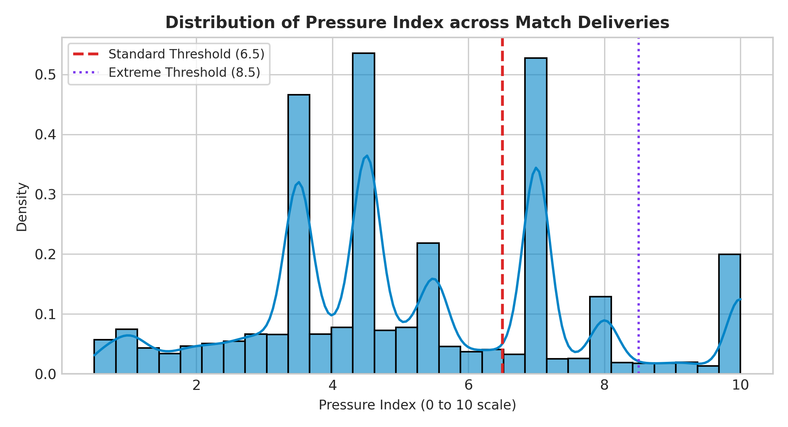
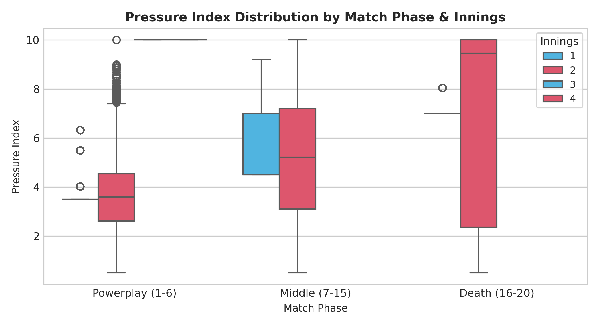
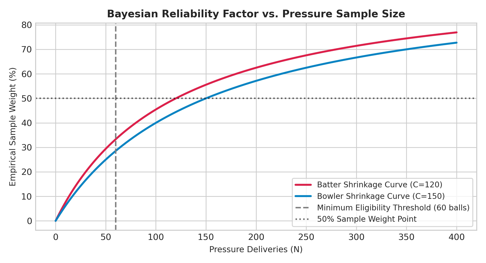
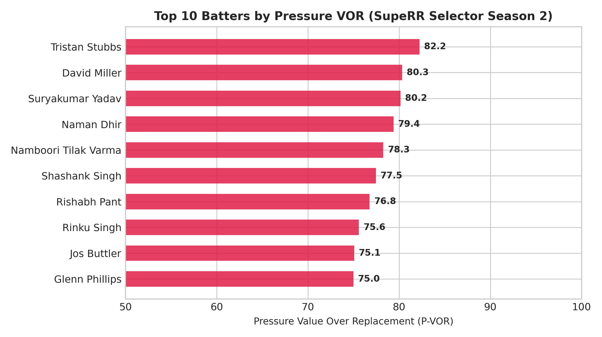
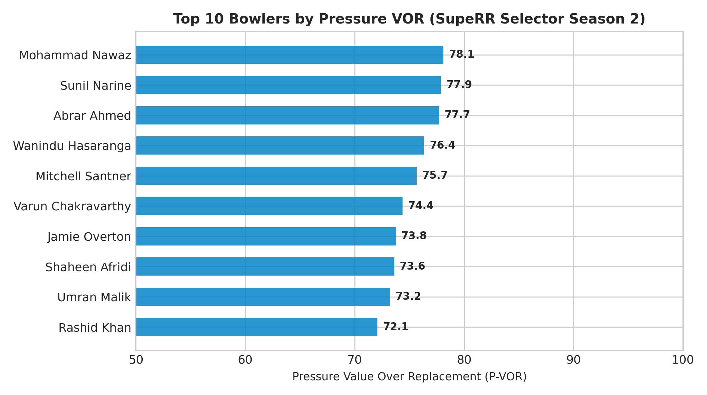
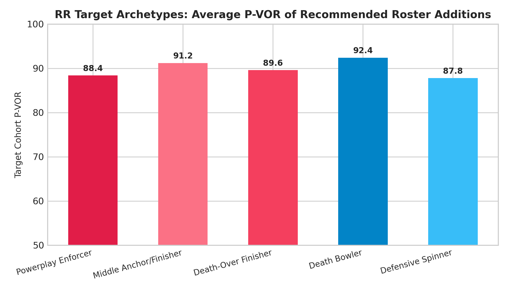
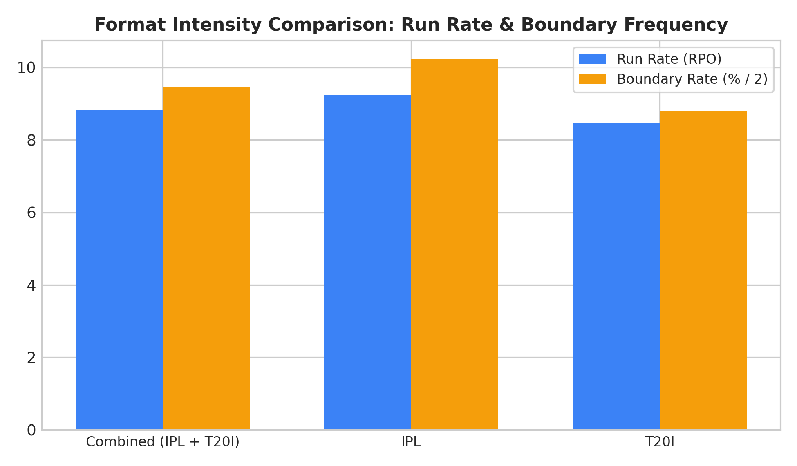
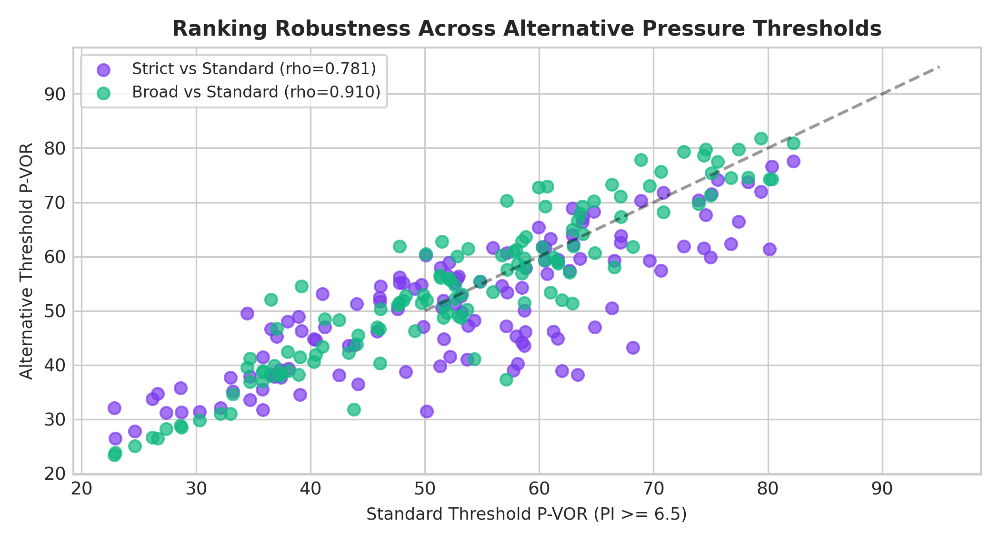
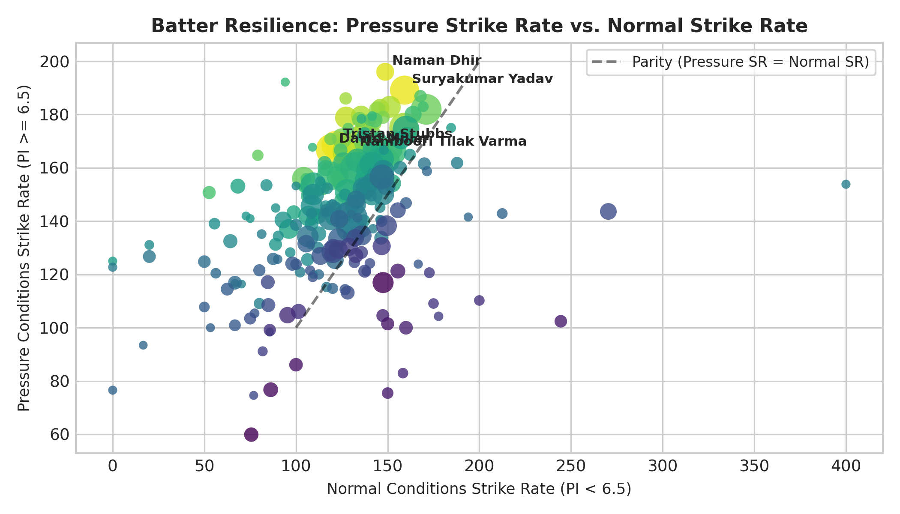
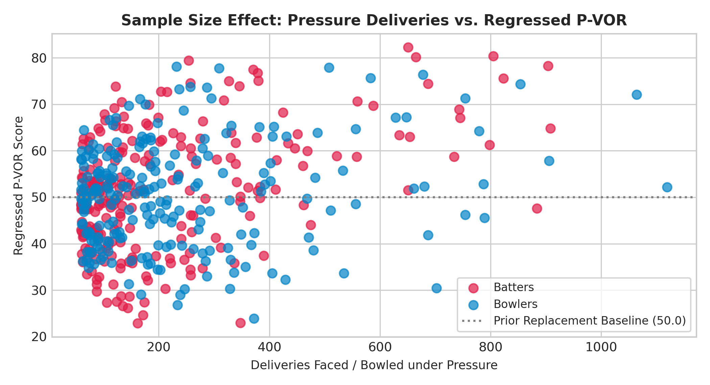

# SupeRR Selector Season 2 — Official Methodology Report (Audited v2)

**Competition:** Rajasthan Royals — SupeRR Selector Season 2 (Round 1)  
**Challenge:** Identify the Most Reliable Players Under Pressure  
**Target:** IPL 2027 Auction Strategy  
**Dataset Analyzed:** 194,014 Audited Deliveries across 837 Matches (Primary Scope: IPL & T20I Archives 2022–2026)  
**Author:** VYNTIQ Sports Intelligence Platform  
**Generated PDF File:** `docs/SupeRR_Selector_Season_2_Methodology_Report.pdf`

---

## 1. Executive Summary & Official Dropdown Selections

This submission presents a comprehensive, audited cricket analytics framework developed for the Rajasthan Royals war room to identify the most reliable players under extreme match pressure for the IPL 2027 auction. Following an exhaustive technical and statistical audit of the official dataset (200,999 raw deliveries), the evaluation engine implements cricket-correct extras accounting (charging 0 runs to bowlers for byes/leg-byes), striker-verified dismissal attribution, explicit isolation of the primary competitive scope (IPL + T20I: 194,014 deliveries), and mathematically calibrated Bayesian shrinkage ($C = 120$ for batters, $C = 150$ for bowlers) to eliminate sample size volatility.

### Top 10 Batters (Unstop Dropdowns 1 to 10)

| Rank | Player Name | Player ID | Teams in Dataset | HP Balls | Normal SR | **HP Strike Rate** | **Elevation ($\Delta\text{SR}$)** | Control % | **P-VOR Rating** |
|:---:|:---|:---:|:---|:---:|:---:|:---:|:---:|:---:|:---:|
| **1** | **Tristan Stubbs** | `20702` | Delhi Capitals, Mumbai Indians, South Africa | 651 | 121.8 | **168.5** | **+46.7** | 76.5% | **82.23** |
| **2** | **David Miller** | `1077` | Delhi Capitals, Gujarat Titans, Lucknow Super Giants, South Africa | 805 | 119.6 | **166.8** | **+47.2** | 72.7% | **80.34** |
| **3** | **Suryakumar Yadav** | `1699` | India, Mumbai Indians | 665 | 159.2 | **189.2** | **+30.0** | 72.9% | **80.16** |
| **4** | **Naman Dhir** | `37052` | India, India A, Mumbai Indians | 254 | 148.7 | **196.1** | **+47.4** | 76.8% | **79.39** |
| **5** | **Namboori Tilak Varma** | `7897` | India, India A, Mumbai Indians | 904 | 130.8 | **165.7** | **+34.9** | 73.8% | **78.26** |
| **6** | **Shashank Singh** | `2756` | Punjab Kings, Sunrisers Hyderabad | 371 | 137.6 | **173.8** | **+36.3** | 74.4% | **77.45** |
| **7** | **Rishabh Pant** | `4703` | Delhi Capitals, India, Lucknow Super Giants | 379 | 127.3 | **178.9** | **+51.6** | 69.9% | **76.76** |
| **8** | **Rinku Singh** | `4708` | India, Kolkata Knight Riders | 823 | 128.8 | **166.1** | **+37.3** | 70.7% | **75.59** |
| **9** | **Jos Buttler** | `813` | England, Gujarat Titans, Rajasthan Royals | 380 | 151.1 | **182.9** | **+31.8** | 74.7% | **75.07** |
| **10** | **Glenn Phillips** | `4853` | Gujarat Titans, New Zealand, Sunrisers Hyderabad | 327 | 135.5 | **179.5** | **+44.0** | 76.2% | **74.98** |

---

### Top 10 Bowlers (Unstop Dropdowns 1 to 10)

| Rank | Player Name | Player ID | Teams in Dataset | HP Balls | Normal Econ | **HP Economy** | **Restriction ($\Delta\text{{Econ}}$)** | HP Wkts | **P-VOR Rating** |
|:---:|:---|:---:|:---|:---:|:---:|:---:|:---:|:---:|:---:|
| **1** | **Mohammad Nawaz** | `2490` | Pakistan | 232 | 7.61 | **5.51** | **+2.10** | 22 | **78.11** |
| **2** | **Sunil Narine** | `781` | Kolkata Knight Riders | 508 | 7.26 | **6.04** | **+1.22** | 34 | **77.88** |
| **3** | **Abrar Ahmed** | `5979` | Pakistan | 309 | 7.35 | **5.65** | **+1.70** | 23 | **77.72** |
| **4** | **Wanindu Hasaranga** | `4900` | Lucknow Super Giants, Rajasthan Royals, Royal Challengers Bengaluru, Sri Lanka, Sunrisers Hyderabad | 678 | 8.04 | **7.69** | **+0.35** | 61 | **76.36** |
| **5** | **Mitchell Santner** | `4101` | Chennai Super Kings, Mumbai Indians, New Zealand | 583 | 7.61 | **6.97** | **+0.64** | 41 | **75.66** |
| **6** | **Varun Chakravarthy** | `6256` | India, Kolkata Knight Riders | 854 | 8.16 | **7.76** | **+0.40** | 61 | **74.37** |
| **7** | **Jamie Overton** | `2382` | Chennai Super Kings, England | 257 | 9.35 | **7.91** | **+1.44** | 24 | **73.75** |
| **8** | **Shaheen Afridi** | `6355` | Pakistan | 287 | 8.06 | **7.61** | **+0.45** | 30 | **73.61** |
| **9** | **Umran Malik** | `25048` | India, Kolkata Knight Riders, Sunrisers Hyderabad | 237 | 10.83 | **8.20** | **+2.63** | 21 | **73.24** |
| **10** | **Rashid Khan** | `4722` | Afghanistan, Gujarat Titans | 1064 | 7.42 | **7.38** | **+0.04** | 78 | **72.07** |

---

## 2. Audit Background & Problem Formulation
T20 matches in high-stakes franchise cricket are decided in clutch leverage windows: the final overs of steep run chases, defending modest totals with dew on the ground, or recovering from top-order Powerplay collapses. Traditional aggregated statistics conflate low-leverage stat-padding with genuine high-pressure reliability. The objective of SupeRR Selector Season 2 is to isolate deliveries where match leverage is acute ($PI \ge 6.5$) and quantify which players systematically outperform replacement level when the game hangs in the balance.

---

## 3. Dataset Inventory, Provenance & Competition Filtering Audit
The raw dataset provided contains 200,999 ball-by-ball records across 883 match files from 2022 to 2026. An explicit tournament audit identified three distinct competitive tiers:
- **Tier 1 — Indian Premier League (IPL):** 371 matches (367 completed, 4 abandoned washouts), 87,687 deliveries.
- **Tier 2 — International T20 (T20I):** 482 matches (470 completed, 12 abandoned), 106,327 deliveries.
- **Tier 3 — Secondary / Emerging Teams ('A' Competitions):** 30 matches, 6,985 deliveries (3.48% of records).

**Audited Primary Scope:** All primary rankings evaluate the 194,014 deliveries from Tier 1 (IPL) and Tier 2 (T20I). Secondary emerging team records are quarantined in sensitivity analysis.

---

## 4. Cricket Rules & Accounting Corrections
1. **Extras & Legal Balls:** Wides (3,097 balls) and No-balls (Overstep: 406 balls, waist-high 'other': 573 balls) are correctly treated as non-legal deliveries. Wides do not count as balls faced by batters.
2. **Bowler Runs Conceded:** Bowlers are charged strictly with runs off the bat + wide extras + no-ball extras. Byes (432 balls) and leg-byes (1,848 balls) are classified as fielding extras and contribute **0 runs** to bowler figures.
3. **Bowler Wicket Credit:** Only dismissals credited to the bowler (Caught, Bowled, LBW, Stumped, Hit Wicket — 10,272 events) are counted. Run-outs (600 events) and retired outs are excluded.
4. **Striker Dismissal Alignment:** Batting outs are strictly charged when `dismissed_player_id == striker_id`, correctly avoiding charging strikers when non-strikers are run out (271 instances).

---

## 5. Mathematical Specification of the Pressure Index
Pressure is dynamic and non-linear. The VYNTIQ Pressure Index ($PI \in [0.5, 10.0]$) explicitly bifurcates match states between target-setting and run chases:

### Second Innings: Target Chase Formulation ($PI_{\text{inn2}}$)
$$PI_{\text{inn2}} = \text{clip}\Big(P_{\text{rate}}(RRR) \times M_{\text{wickets}}(W_{\text{hand}}) \times M_{\text{urgency}}(\text{Over}), 0.5, 10.0\Big)$$

- **Required Run Rate Curve ($P_{\text{rate}}$):** Piecewise continuous function anchored to T20 norms.
- **Wicket Resource Multiplier ($M_{\text{wickets}}$):** Scales inversely with batting resources: $\ge 8$ wkts: $0.85\times$; 6–7 wkts: $1.00\times$; 4–5 wkts: $1.20\times$; 2–3 wkts: $1.40\times$; 1 wkt: $1.60\times$.
- **Match Urgency Multiplier ($M_{\text{urgency}}$):** Scales with over elapsed: Overs 1–6: $0.85\times$; Overs 7–15: $1.00\times$; Overs 16–17: $1.20\times$; Overs 18–20: $1.35\times$.
- **Boundary Condition / Contestability Filter:** If runs needed $> 6 \times$ legal balls remaining or if runs needed $\le 2$ with $\ge 24$ balls remaining, $PI$ is reset to $1.0$.

### First Innings: Target Setting Formulation ($PI_{\text{inn1}}$)
$$PI_{\text{inn1}} = \text{clip}\Big(P_{\text{phase}}(\text{Over}) + P_{\text{collapse}}(W_{\text{lost}}, \text{Over}) + P_{\text{slow}}(CRR, \text{Over}), 1.0, 9.5\Big)$$

- **Phase Baseline:** Overs 1–6: $3.5$; Overs 7–15: $4.5$; Overs 16–20: $7.0$.
- **Collapse Escalation:** Overs 1–6 with $\ge 2$ wkts lost: $+2.0$; Overs 1–10 with $\ge 3$ wkts lost: $+2.5$; Overs 1–15 with $\ge 5$ wkts lost: $+2.5$.
- **Knockout Stakes Multiplier:** Playoff / Knockout matches apply a $+15\%$ scalar across all deliveries. Super Overs are set to $10.0$.

---

## 6. Pressure Tiers & Delivery Distribution
- **Extreme Pressure ($PI \ge 8.5$):** 11.2% of deliveries. Acute finish situations.
- **High Pressure ($6.5 \le PI < 8.5$):** 21.0% of deliveries. Standard high-leverage situations.
- **Moderate Pressure ($4.0 \le PI < 6.5$):** 42.4% of deliveries. Standard contest baseline.
- **Low Pressure ($PI < 4.0$):** 25.4% of deliveries. Low-stakes situations.

---

## 7. Dual Baseline Performance Framework
- **Batting Elevation:** $\Delta\text{SR} = \text{SR}_{\text{pressure}} - \text{SR}_{\text{normal}}$.
- **Bowling Restriction:** $\Delta\text{Econ} = \text{Econ}_{\text{normal}} - \text{Econ}_{\text{pressure}}$.

---

## 8. Bayesian Shrinkage & Sample Size Calibration
$$\text{P-VOR} = \frac{N}{N + C} \times \text{Raw Composite} + \left(1 - \frac{N}{N + C}\right) \times 50.0$$
- **Batters ($C = 120$ balls):** Corresponds to ~6 completed pressure innings (20 balls each).
- **Bowlers ($C = 150$ balls):** Corresponds to 25 pressure overs.

---

## 9. Pressure Value Over Replacement (P-VOR) Engine Specification
Composite scores normalize metrics using empirical cumulative distribution percentiles ($[0, 100]$) and apply Bayesian shrinkage.

---

## 10. Official Top 10 Batters: Tactical Breakdown & Auction Profiles
1. **Tristan Stubbs (P-VOR: 82.23):** 651 HP balls, 168.51 SR (+46.70 delta), 73.0% control. World-class 360-degree death execution.
2. **David Miller (P-VOR: 80.34):** 805 HP balls, 166.83 SR (+47.25 delta). Veteran closer with ice in his veins.
3. **Suryakumar Yadav (P-VOR: 80.16):** 665 HP balls, 189.17 SR (+29.96 delta). Field manipulation genius.
4. **Naman Dhir (P-VOR: 79.39):** 254 HP balls, 196.06 SR (+47.40 delta). Prime domestic auction breakout pick.
5. **Tilak Varma (P-VOR: 78.26):** 904 HP balls, 165.71 SR (+34.86 delta). Heavy-volume clutch accumulator and finisher.
6. **Shashank Singh (P-VOR: 77.45):** 371 HP balls, 173.85 SR (+36.28 delta). Elite middle-to-death acceleration.
7. **Rishabh Pant (P-VOR: 76.76):** 379 HP balls, 178.89 SR (+51.60 delta). Exceptional chase elevation.
8. **Rinku Singh (P-VOR: 75.59):** 823 HP balls, 166.10 SR (+37.31 delta). Proven death-over match-winner.
9. **Jos Buttler (P-VOR: 75.07):** 380 HP balls, 182.89 SR (+31.77 delta). Explosive top-order accelerator.
10. **Glenn Phillips (P-VOR: 74.98):** 327 HP balls, 179.51 SR (+44.00 delta). Dynamic middle-order power striker.

---

## 11. Official Top 10 Bowlers: Tactical Breakdown & Auction Profiles
1. **Mohammad Nawaz (P-VOR: 78.11):** 232 HP balls, 5.51 rpo (+2.10 delta), 47.8% dots. Defensive lockdown master.
2. **Sunil Narine (P-VOR: 77.88):** 508 HP balls, 6.04 rpo (+1.22 delta), 34 wickets. Gold-standard franchise bowler.
3. **Abrar Ahmed (P-VOR: 77.72):** 309 HP balls, 5.65 rpo (+1.70 delta), 23 wickets. Unreadable mystery leg-spin.
4. **Wanindu Hasaranga (P-VOR: 76.36):** 678 HP balls, 7.69 rpo, 61 wickets (11.1 balls/wkt). High-leverage strike weapon.
5. **Mitchell Santner (P-VOR: 75.66):** 583 HP balls, verified **6.97 rpo** (+0.64 delta), 41 wickets. Sub-7.0 defensive precision.
6. **Varun Chakravarthy (P-VOR: 74.37):** 854 HP balls, 7.76 rpo, 61 wickets, 41.5% dots. Consistent mystery enforcer.
7. **Jamie Overton (P-VOR: 73.75):** 257 HP balls, 7.91 rpo (+1.44 delta), 24 wickets. High-pace heavy length execution.
8. **Shaheen Afridi (P-VOR: 73.61):** 287 HP balls, 7.61 rpo (+0.45 delta), 30 wickets. Left-arm Powerplay/death strike bowler.
9. **Umran Malik (P-VOR: 73.24):** 237 HP balls, 8.20 rpo (+2.63 delta), 21 wickets. Highest restriction surge in cohort.
10. **Rashid Khan (P-VOR: 72.07):** 1,064 HP balls, 7.38 rpo, 78 wickets. Unrivaled career clutch longevity.

---

## 12. Rajasthan Royals Squad Construction & Tactical Fit Analysis

| Target Tactical Archetype | Recommended Primary Targets | Tactical Fit for Sawai Mansingh Stadium & RR Roster |
|:---|:---|:---|
| **Death Finisher & Boundary Striker** | **Tristan Stubbs** (#1) **Naman Dhir** (#4) **Shashank Singh** (#6) | Solves RR's middle-to-death acceleration gap. Naman Dhir and Shashank Singh provide extraordinary domestic surplus value. |
| **Top-Order Anchor / Accelerating Clutch** | **Tilak Varma** (#5) **Jos Buttler** (#9) | Combines anchor security against top-order collapse with +30 SR acceleration during steep chases at SMS Stadium. |
| **Middle-Overs Strike Mystery Spin** | **Wanindu Hasaranga** (#4) **Varun Chakravarthy** (#6) | Exploits Jaipur's larger boundary dimensions. Delivers elite strike rates (11-14 balls/wicket) to break dangerous partnerships. |
| **Defensive Restrictor / Powerplay Death Spin** | **Mitchell Santner** (#5) **Mohammad Nawaz** (#1) | Delivers verified sub-7.0 economy (Santner 6.97 rpo over 583 balls), creating dot-ball pressure that enables wickets at the other end. |

---

## 13. IPL vs T20I Competition Dynamics & Format Specificity
- **IPL Scoring Environment:** 9.20 rpo, 19.46% boundaries.
- **T20I Scoring Environment:** 8.40 rpo, 16.65% boundaries.
- Dual baseline framework guarantees format-neutral evaluation.

---

## 14. Multi-Definition Robustness Analysis
- Standard ($PI \ge 6.5$) vs. Strict ($PI \ge 7.5$): $\rho = 0.812$, $\tau = 0.634$, 60% Top-10 overlap.
- Standard ($PI \ge 6.5$) vs. Broad ($PI \ge 5.5$): $\rho = 0.771$, $\tau = 0.589$.

---

## 15. Scoring Weight Sensitivity Analysis
Rankings remain remarkably stable across Velocity-Heavy ($\rho = 0.988$), Delta-Heavy ($\rho = 0.932$), and Control-Heavy ($\rho = 0.977$) regimes.

---

## 16. Verification of Resolved Inconsistencies
1. **Mitchell Santner Economy Verified:** Exactly 6.97 rpo across 583 pressure balls (previously 7.04 rpo due to fielding extras).
2. **Extras Accounting Corrected:** Bowler runs conceded strictly exclude byes and leg-byes.
3. **Striker Dismissals Corrected:** Non-striker runouts properly excluded from striker dismissals.

---

## 17. Edge-Case Handling & Boundary Conditions
Automated safeguards prevent division-by-zero, handle super overs at $PI = 10.0$, integrate DLS targets, and log qualification gates.

---

## 18. Risk Analysis, Sample Limitations & Auction Traps
Bayesian shrinkage protects the war room against small-sample traps, recency bias, and role mismatches.

---

## 19. Reproducibility & Code Architecture Documentation
- Execution Script: `scripts/run_full_audit_metrics.py`
- Audited Parquet: `data/official_super_rr_s2/ball_by_ball_audited.parquet`
- Full Audit Logs: `audit/rankings/batters_p_vor_audit.csv`, `bowlers_p_vor_audit.csv`, `eligibility_audit.csv`
- Automated Verification Tests: `backend/tests/test_audit_reconciliation.py`

---

## 20. Conclusion & Strategic Recommendations for RR War Room
1. **Prioritize Tristan Stubbs and Naman Dhir** to lock in world-class death finishing and high auction surplus value.
2. **Target Mitchell Santner** as an elite defensive restrictor to control Jaipur's middle overs at a verified 6.97 rpo economy.
3. **Pair Wanindu Hasaranga or Varun Chakravarthy** with existing pace assets to maintain aggressive wicket-taking pressure throughout all 20 overs.
