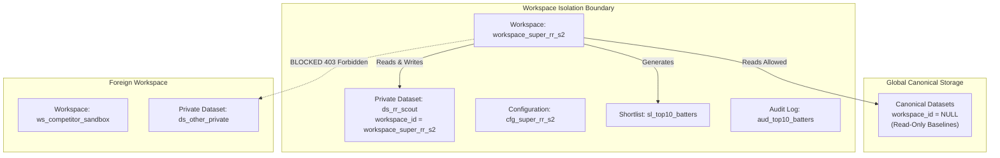
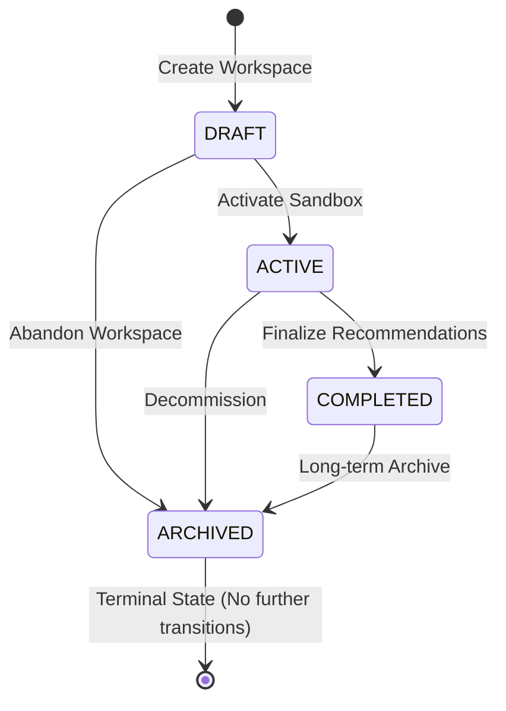
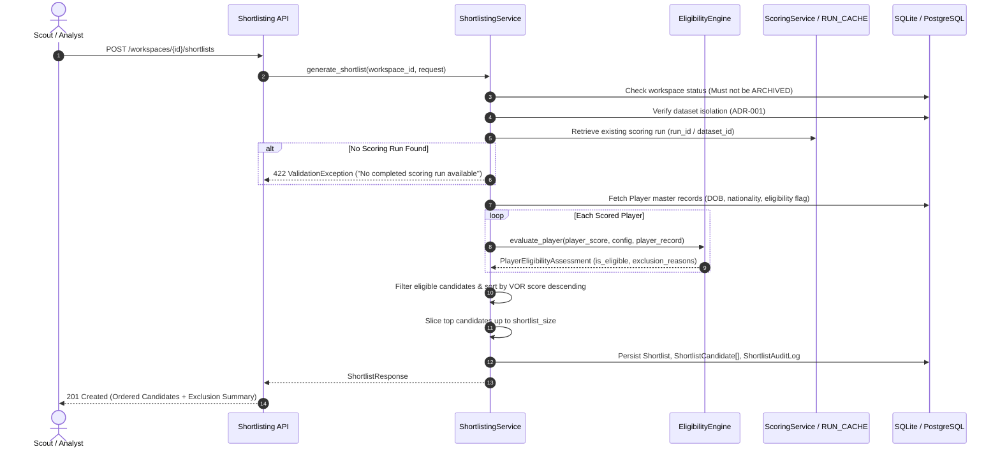
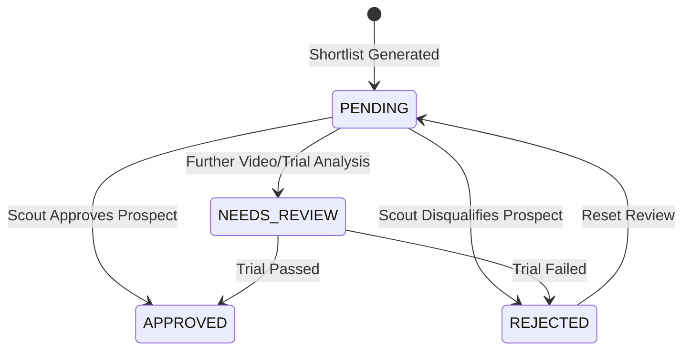

# VYNTIQ — Competition Workspace & Shortlisting Engine Specification

**Document Reference:** SPEC-VYNTIQ-009  
**Document Version:** 1.0.0 (Prompt 09 Implementation)  
**Status:** Approved Architectural Specification  
**Parent Product:** VYNTIQ — Sports Intelligence ("Every Metric Tells a Story.")  

---

## 1. Architectural Scope & Product Alignment

VYNTIQ is an independent, sport-extensible analytics platform. Competition environments—such as the **SuperRR Selector Season 2** competition (`workspace_super_rr_s2`)—operate strictly as isolated competition workspaces (analytical sandboxes), not as the core product brand.

The **Competition Workspace and Shortlisting Engine** provides:
1. Workspace lifecycle management (`DRAFT`, `ACTIVE`, `COMPLETED`, `ARCHIVED`).
2. Configurable competition rules (target roles, age limits, participation thresholds, shortlist sizes).
3. Eligibility evaluation with non-silent machine-readable exclusion tracking.
4. Shortlist generation that consumes previously stored, verified scoring runs (`PlayerScoreResult`).
5. Analyst/scout candidate review workflows (`PENDING`, `APPROVED`, `REJECTED`, `NEEDS_REVIEW`) without mutating original evaluation scores.
6. Immutable audit trails ensuring deterministic reproducibility.

---

## 2. Workspace Isolation Strategy (ADR-001 Option C)

In accordance with **ADR-001**, VYNTIQ implements shared database tables with explicit `workspace_id` foreign keys and `origin_type` provenance stamping:

- **Canonical Benchmarks**: Multi-year historical IPL, international, and domestic datasets have `workspace_id = NULL` and are globally accessible as read-only baselines.
- **Competition Sandboxes**: Client/competition datasets are explicitly stamped with `workspace_id` (e.g. `workspace_super_rr_s2`).
- **Enforcement**: Any analytical operation (shortlist generation, dataset retrieval) attempting to access a dataset stamped with a different `workspace_id` is blocked with HTTP 403 (`WorkspaceException`).



---

## 3. Workspace Lifecycle State Machine

Workspaces progress through four explicit lifecycle states. Invalid transitions are rejected at the service boundary with HTTP 422 (`ValidationException`):



| Source State | Allowed Target States | Disallowed Transitions | Behavior |
| :--- | :--- | :--- | :--- |
| `DRAFT` | `ACTIVE`, `ARCHIVED` | `COMPLETED` | Initial setup, configuration, dataset linkage. |
| `ACTIVE` | `COMPLETED`, `ARCHIVED` | `DRAFT` | Live shortlisting, candidate evaluations, analyst reviews. |
| `COMPLETED` | `ARCHIVED` | `DRAFT`, `ACTIVE` | Selections finalized; shortlists locked against regeneration. |
| `ARCHIVED` | *None (Terminal)* | `DRAFT`, `ACTIVE`, `COMPLETED` | Read-only historical record. Cannot generate shortlists. |

---

## 4. Configuration Structure & Eligibility Processing

Competition requirements are separated into **Performance Evaluation** and **Eligibility Processing**. Eligibility criteria never modify statistical VOR formulas.

### 4.1 Configuration Schema

```json
{
  "target_sport": "CRICKET",
  "target_roles": ["BATTER", "ALL_ROUNDER"],
  "age_criteria": {
    "min_age": 19,
    "max_age": 24,
    "age_cutoff_date": "2026-11-01"
  },
  "participation_criteria": {
    "min_matches": 5,
    "min_balls_faced": 60,
    "min_legal_balls_bowled": null
  },
  "required_metrics": ["batting_strike_rate", "true_strike_rate"],
  "evaluation_profile_version": "1.0.0",
  "shortlist_size": 10,
  "custom_eligibility_rules": {
    "allowed_nationalities": ["IND"]
  },
  "dataset_ids": ["ds_super_rr_s2"]
}
```

### 4.2 Non-Silent Exclusion Rules

Every candidate exclusion produces a machine-readable reason:

| Eligibility Rule | Exclusion Trigger | Machine-Readable Reason Recorded |
| :--- | :--- | :--- |
| **Role Restriction** | `assigned_role` $\notin$ `target_roles` | `"Assigned role '<role>' is not in configured competition roles: [...]"` |
| **Age Minimum** | `calculated_age < min_age` | `"Player age (<age> years) is below minimum age requirement of <min_age> years"` |
| **Age Maximum** | `calculated_age > max_age` | `"Player age (<age> years) exceeds maximum age requirement of <max_age> years"` |
| **Missing DOB** | `dob is None` when age criteria set | `"Player date of birth is unavailable for competition age verification"` |
| **Batting Workload** | `balls_faced < min_balls_faced` | `"Balls faced (<N>) is below minimum requirement of <threshold>"` |
| **Bowling Workload** | `legal_balls_bowled < min_legal_balls` | `"Legal balls bowled (<N>) is below minimum requirement of <threshold>"` |
| **Nationality** | `nationality` $\notin$ `allowed_nationalities` | `"Player nationality '<nat>' is not in allowed competition nationalities: [...]"` |
| **Master Flag** | `player.is_eligible == False` | `"Player master record has explicit eligibility flag set to False"` |

---

## 5. Shortlist Generation Flow

The shortlisting engine **strictly consumes existing scoring runs** (`ScoringRunResponse` / `PlayerScoreResult`) rather than re-calculating VOR scores or inventing new ratings:



---

## 6. Shortlist Candidate Review Lifecycle

Analysts review shortlisted candidates without mutating underlying statistical calculations:



### Review Immutability Guarantee
When updating a candidate via `POST /workspaces/{id}/shortlists/{sl_id}/candidates/{player_id}/review`:
- **Updated Fields**: `review_status` (`APPROVED`, `REJECTED`, `NEEDS_REVIEW`, `PENDING`), `reviewer_notes`.
- **Immutable Fields**: `rank`, `vor_score`, `raw_composite_score`, `reliability_factor`, `reliability_status`, `evaluation_ref`, `explainability_ref`.

---

## 7. Audit Trail & Reproducibility

Every shortlist run records an immutable `ShortlistAuditLog` entity:

| Audit Attribute | Description |
| :--- | :--- |
| `audit_id` | Unique UUID (`aud_...`) |
| `shortlist_id` | Reference to the generated shortlist |
| `workspace_id` | Scoped workspace |
| `dataset_id` | Evaluated dataset |
| `configuration_version` | Active version of the competition configuration (e.g. `1.0.0`) |
| `evaluation_methodology_version` | Active scoring profile version (e.g. `1.0.0`) |
| `metric_registry_version` | Metric definitions registry version (`1.0.0`) |
| `ranking_engine_version` | Ranking engine release version (`1.0.0`) |
| `generation_timestamp` | ISO-8601 UTC timestamp |
| `eligible_candidate_count` | Number of players passing all eligibility filters |
| `excluded_candidate_count` | Number of players excluded |
| `shortlisted_candidate_count` | Number of players selected into the shortlist |
| `exclusion_details` | Machine-readable dictionary mapping excluded `player_id` to reason strings |

### Deterministic Reproducibility
Running a duplicate shortlist request against the same dataset and configuration version produces the identical ranked candidate sequence with matching VOR scores.

---

## 8. REST API Reference

| Method | Endpoint | Description |
| :--- | :--- | :--- |
| `POST` | `/api/v1/workspaces` | Provision a new competition workspace with initial configuration. |
| `GET` | `/api/v1/workspaces` | List all workspaces with optional status filter. |
| `GET` | `/api/v1/workspaces/{workspace_id}` | Retrieve full workspace details, active configuration, and shortlist count. |
| `PATCH` | `/api/v1/workspaces/{workspace_id}` | Modify workspace metadata or transition lifecycle status. |
| `DELETE` | `/api/v1/workspaces/{workspace_id}` | Archive a workspace (`ARCHIVED` state). |
| `GET` | `/api/v1/workspaces/{workspace_id}/configuration` | Retrieve active evaluation and eligibility configuration. |
| `PUT` | `/api/v1/workspaces/{workspace_id}/configuration` | Update competition configuration parameters. |
| `GET` | `/api/v1/workspaces/{workspace_id}/datasets` | Retrieve datasets accessible to this workspace. |
| `POST` | `/api/v1/workspaces/{workspace_id}/shortlists` | Generate candidate shortlist from existing scoring runs. |
| `GET` | `/api/v1/workspaces/{workspace_id}/shortlists` | List past shortlists for this workspace. |
| `GET` | `/api/v1/workspaces/{workspace_id}/shortlists/{shortlist_id}` | Retrieve shortlist details, ranked candidates, and exclusion summary. |
| `POST` | `/api/v1/workspaces/{workspace_id}/shortlists/{shortlist_id}/candidates/{player_id}/review` | Submit scout review disposition (`APPROVED`, `REJECTED`, `NEEDS_REVIEW`) and notes. |
| `GET` | `/api/v1/workspaces/{workspace_id}/shortlists/{shortlist_id}/audit` | Retrieve audit log with configuration versions and machine-readable exclusion reasons. |

---

## 9. Known Limitations & Future Roadmap (Track B)

1. **Static Roles**: Player roles are presently sourced from the canonical classifier or source master. Dynamic multi-role shortlisting (e.g., dual-slotting an All-Rounder as both Batter and Bowler) will be expanded in Track B.
2. **Auction Budgeting Constraints**: Shortlist size is presently cardinally bounded ($K \in [1, 100]$); auction purse/budget simulation constraints will be incorporated in Prompt 10.
3. **Multi-User RBAC**: Currently relies on workspace tenant scoping; granular scout-level permissions (e.g. Lead Scout vs. Junior Analyst signoff) will be introduced in Track B.

